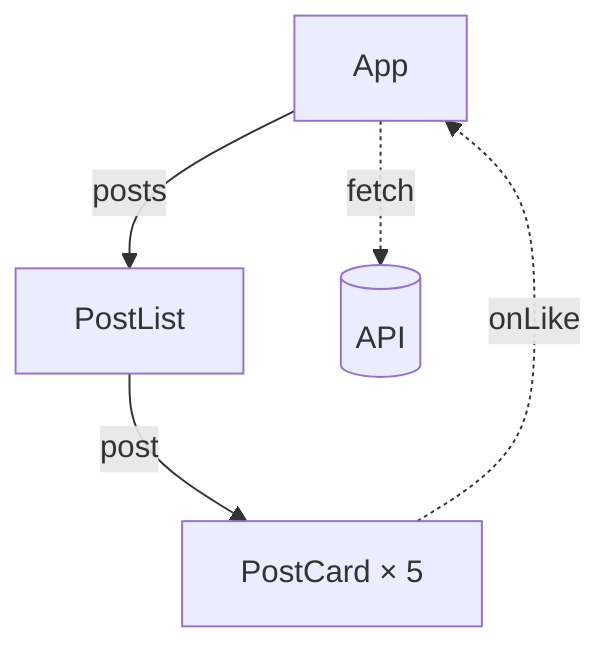

# Plan: React ЛР-4 «Практична реалізація хуків useState та useEffect у клієнтських компонентах»

Status: proposed on 2026-11-08 and revised the same day: the instructor
added a graded task worth +1 point that moves the state from `App` into a
new `FilterableMenuTable` (§4.7). Built the same day on branch
`feat/react-lab-4`, Ukrainian only, without the PDF until the instructor has
reviewed the handout. The lasting facts and what was verified are in this
folder's [README.md](README.md); this file stays as the plan the lab was
built from.

Deviations from the plan:

- **The title is the programme's in full,** «…у клієнтських компонентах»,
  as ЛР-3's is, rather than shortened.
- **§4.2's DevTools step names the keys.** React DevTools 8 accepts only
  JSON for a string state, and a double-click on `""` selects one quote, so
  the handout says `Ctrl+A`, then `"чай"` with the quotes, then `Enter`. The
  boolean is ticked with the checkbox at the right edge of the panel.
- **The §4.8 reset button is always shown,** not only while a filter is
  active: a button that disappears when pressed drops keyboard focus to
  `<body>`. Its label is «Скинути фільтри».
- **The screenshot's query is «к»** with the checkbox ticked, which leaves
  «Кава (2)» and «Десерти (2)». No query leaves two categories and also
  shows the checkbox hiding something.
- **The highlight setting was found and checked** in DevTools 8 (Components
  ⚛ gear → General), so the Profiler fallback isn't in the handout.
- **`course-plan.md` notes the extra point** next to the grading rules and
  leaves decision 8 open there.
- **§4.7 is tasks only** (the instructor's review, 2026-11-08): measure with
  the highlight, refactor, measure again, and write «До:» and «Після:» in a
  new «Колокація стану» section of the README. The explanations, the
  reading of the diagram, the react.dev mapping table, the full `App.jsx`
  and §4.7's «Що має вийти» are gone; §7's +1 table holds the checks. §7
  gains a «Порівняння» row; the second commit is
  `docs: compare renders before and after state colocation`.
- **The answers left this file** (PR review, 2026-11-08). The repository
  is public, and the defence asks for what §4.7 no longer explains. The
  code after §4.7, both diagram answers, the expected «До:» and «Після:»
  lists and the reasons behind them are in the gitignored
  `solution/README.md` and `solution/src/`, as ЛР-3's answer key is; the
  sections below that held them now point there. The review also dropped
  the `<title>` defence question, which nothing in the lab covers.

## Context

From [../course-plan.md](../course-plan.md), row 1.6:

- **Тема:** «Практична реалізація хуків useState та useEffect у клієнтських
  компонентах»
- **Самостійна робота:** «Розробка інтерактивних віджетів» (2 год.)
- **Читання:** Основна 1 (react.dev), 4 (Wieruch, The Road to React)
- **Position:** after Лекція 2 (state, `useState`, `useEffect`, the React 19
  hooks) and ЛР-3, before ЛР-5 (events, controlled and uncontrolled
  components), ЛР-6 (forms, Actions, React Hook Form, Zod) and ЛР-7 (custom
  hooks).

ЛР-3 ends with state on paper. Students build the «Меню кав'ярні» page from
components following Thinking in React steps 1–2, then fill in a table in
the README for steps 3–4: the search text and the «Лише в наявності» checkbox
are state, and that state lives in `App`. ЛР-3 lets `App` take the place of
react.dev's `FilterableProductTable` instead of wrapping it. Its search field
and checkbox render but do nothing. **ЛР-4 picks up there:** steps 4 and 5
in code, then one effect that keeps the state in sync with something outside
React. Then, for an extra point, the state moves down into a component made
to hold it, which is react.dev's final structure.

The constraints are ЛР-1–3's:

1. No «Теоретична частина»: the handout gives useful links instead.
2. The tasks are straightforward and take 20–30 minutes.
3. Every task is done in class, and the code is written by hand.

### The readings

| Page | Language on 2026-11-08 | Use |
| --- | --- | --- |
| [Thinking in React](https://uk.react.dev/learn/thinking-in-react) | **English only** | steps 4 and 5: the main page of the lab |
| [Філософія React](https://uk.legacy.reactjs.org/docs/thinking-in-react.html) (legacy docs) | Ukrainian | the same steps 4–5; its code is class components (`this.state`), so read it for the method |
| [Стан: пам'ять компонента](https://uk.react.dev/learn/state-a-components-memory) | Ukrainian | `useState`, why a plain variable doesn't work |
| [Поширення стану між компонентами](https://uk.react.dev/learn/sharing-state-between-components) | Ukrainian | lifting state up to the common parent; its section on controlled and uncontrolled components is the bridge to ЛР-5 |
| [Реагування на події](https://uk.react.dev/learn/responding-to-events) | Ukrainian | `onChange`, passing event handlers as props |
| [Synchronizing with Effects](https://uk.react.dev/learn/synchronizing-with-effects) | **English only** | what an effect is, the dependency array, the double run in development |
| [You Might Not Need an Effect](https://uk.react.dev/learn/you-might-not-need-an-effect) | **English only** | why the filtering isn't an effect |
| [Використовуємо хук ефекту](https://uk.legacy.reactjs.org/docs/hooks-effect.html) (legacy docs) | Ukrainian | `useEffect` in Ukrainian; its examples are function components |
| [`useState`](https://uk.react.dev/reference/react/useState), [`useEffect`](https://uk.react.dev/reference/react/useEffect) | **English only** (the reference pages) | the initializer function; dependency arrays |
| [State Colocation will make your React app faster](https://kentcdodds.com/blog/state-colocation-will-make-your-react-app-faster) (Kent C. Dodds) | English | §4.7: keep state as close as possible to where it's used; Epic React is reading 6 |

Anchors the «Довідка» links use, all checked on 2026-11-08:

- Thinking in React: `#step-4-identify-where-your-state-should-live`,
  `#step-5-add-inverse-data-flow`; the legacy page has the same two ids.
- Synchronizing with Effects: `#step-1-declare-an-effect`,
  `#step-2-specify-the-effect-dependencies`,
  `#how-to-handle-the-effect-firing-twice-in-development`.
- `useState`: `#avoiding-recreating-the-initial-state`.
- Sharing state: `#controlled-and-uncontrolled-components`.
- Responding to events: `#passing-event-handlers-as-props`.

Step 4 on react.dev says, checked on 2026-11-08: «You can also put the
state into some component above their common parent. If you can't find a
component where it makes sense to own the state, create a new component
solely for holding the state and add it somewhere in the hierarchy above
the common parent component». Its final code has `App` render only
`<FilterableProductTable products={PRODUCTS} />`. §4.7 rests on both.

Wieruch's book is paid, so §2 links only react.dev, the legacy docs and the
one free article, as ЛР-3 did with Epic React.

## The idea: the same menu, now working

The starter is ЛР-3's finished main task plus one new component. It has
`App`, `SearchBar`, `MenuTable`, `MenuCategory` and `MenuItemRow` in their
own files, `data.js`, and **`CafeInfo`**, a small block of opening hours
under the table that takes no props. The search field and the checkbox will
work this time. Students do five things:

1. **Крок 4 in code.** Two `useState` calls in `App`. The values go down as
   props to `SearchBar` (shown in the field and the checkbox) and to
   `MenuTable` (which filters by them). The fields are now read-only, and
   React says why in the console, just as react.dev's step 4 describes.
   Editing the state in **Components ⚛** filters the table.
2. **Крок 5: зворотний потік даних.** `App` passes its setters to
   `SearchBar`, and `onChange` calls them. Typing filters the table.
3. **`useEffect`.** After a reload the filters are lost. An effect saves them
   to `localStorage`, and initializer functions in `useState` read them back.
4. **The data flow on a diagram.** The hierarchy in the README gets labelled
   arrows: props going down, the setter calls coming back up, and the
   effect writing to `localStorage`. Then the checks, `git push` and Vercel:
   this is the 1-point lab.
5. **+1 бал: колокація стану.** With **Highlight updates when components
   render** on, students note which components re-render while they type.
   They extract `FilterableMenuTable` with ЛР-3's recipe: the two
   `useState` calls and the effect move into it, `App` keeps only the
   page, and the page doesn't change. They note the re-renders again,
   update the diagram and push again. What they should see, and why, is in
   `solution/README.md`.

### Why `CafeInfo` is in the starter

`CafeInfo` is the one part of the page that has nothing to do with the
filters, so §4.7 has something to compare. The reasons the defence asks
for, and why the lab doesn't claim a speed-up, are in
`solution/README.md`.

`CafeInfo` sits in the starter rather than being written in §4.7 to save
class time. §4.1's file table says what it shows, and §4.2 notes that it
gets no props.

### Why `localStorage` for the effect

`useEffect` needs an external system to sync with, and the menu page has to
offer one that doesn't take another lab's topic:

| Candidate | Why not |
| --- | --- |
| Fetch the menu from `public/menu.json` | ЛР-14's topic (HTTP clients, TanStack Query) and presentation П2.4's demo. react.dev also recommends against fetching in effects in real apps. |
| `document.title` with the number of items found | React 19 renders `<title>` from any component and hoists it into `<head>`, so an effect is the outdated way. The lab doesn't teach `<title>`, so it isn't a defence question either. |
| `/` focuses the search (a `keydown` listener on `window`) | The best cleanup example, but keyboard events are ЛР-5's self-study, and it needs `useRef`. |
| A clock or a timer | There's no natural place for one on a menu page. |

`localStorage` is an external system and it shows the parts of `useEffect`
that matter here. It needs a dependency array with two values. It pairs with
the initializer function in `useState`. It has a visible check: the
**Application** tab, then a reload. §4.7 reuses the reload as its proof
that behaviour didn't change, since the keys stay the same. ЛР-7 can turn
the effect into a `useLocalStorage` hook, which is П3.2's demo.

It has no cleanup. The defence asks why none is needed, and Лекція 2 covers
cleanup.

### ESLint already teaches the lesson

`eslint-plugin-react-hooks` 7.1.1, the version ЛР-1 installs, was checked on
2026-11-08 in a `react-labs` workspace with ЛР-1's tooling:

- **Restoring in an effect** is an error. `useEffect(() => {
  setFilterText(localStorage.getItem(…)) }, [])` is reported as
  `react-hooks/set-state-in-effect`: «Calling setState synchronously within
  an effect can trigger cascading renders», with a link to You Might Not Need
  an Effect.
- **Keeping the filtered menu in state through an effect** is the same error,
  which matches what Thinking in React step 3 says about computed data.
- **A dependency missing from the array** (`[filterText]` alone) is a
  warning: `react-hooks/exhaustive-deps`, «missing dependency:
  'inStockOnly'».
- **An effect without an array** that sets state gets both the warning and
  the error.

The handout relies on this: «якщо ESLint підкреслить…» is the check, and
§7 asks for no errors **and no warnings**, since `npm run lint` exits 0 on
warnings.

## Design principles

1. **One page and no theory.** §2 is a list of links; each task links the
   one section it needs.
2. **react.dev's names.** `filterText`, `inStockOnly`, `onFilterTextChange`,
   `onInStockOnlyChange`, and `FilterableMenuTable` after
   `FilterableProductTable`, so the code lines up with react.dev.
3. **The point earned first, the extra point after.** §4.1–4.6 are the
   1-point lab and end with a deployed app. §4.7 starts from that working
   state, so a student who runs out of time loses only the extra point.
4. **Every step in §4.2–4.4 changes what the page does,** so those commits
   are `feat:`. §4.7 changes the structure only, so its commit is
   `refactor:`, as in ЛР-3, with the same check: the page is unchanged.
5. **Small diffs.** `MenuCategory` and `MenuItemRow` never change, and
   `SearchBar` and `MenuTable` don't change in §4.7. The filtering is a pure
   function, `filterMenu`, that comes in the starter, because the lab is
   about React, not array methods. `MenuTable` calls it, so `MenuTable` is
   the component that filters. ЛР-3's answer key says the same: `SearchBar`
   shows the state, `MenuTable` filters by it, and their closest common
   parent is `App`.
6. **Computed data stays computed.** The visible items and the counts in the
   category headings are worked out during render, not stored in state.
   ESLint enforces this (above), and the defence asks about it.
7. **Controlled fields as react.dev's step 5 uses them.** The handout names
   the term «контрольоване поле» once and links the section. Comparing them
   with uncontrolled fields (`defaultValue`, `ref`) is ЛР-5's topic. The React
   warning in §4.2 already mentions `defaultValue`, which ЛР-5 can point
   back to.
8. **«Клієнтський компонент» explained in one sentence.** It's in the title,
   so §4.2 says that in a Vite app every component runs in the browser, so
   all of them are client components, and that is where state and effects
   work. Server components are Лекція 7 and ЛР-20.
9. **Accessibility carries over:** the `<search>` landmark, a label on both
   fields, «— немає» in the text. The checkbox stays inside its `<label>`.
   `CafeInfo` is an `<aside>` with an `<h2>`, so the heading order stays
   `h1` → `h2`.

## The app: what changes

### `src/filterMenu.js`, given in the starter

```js
// Повертає меню лише з тими позиціями, що відповідають тексту пошуку й
// прапорцю «Лише в наявності». Категорії без таких позицій не потрапляють
// у результат. Функція нічого не змінює: вона створює нові масиви.
export function filterMenu(menu, filterText, inStockOnly) {
  const query = filterText.trim().toLowerCase()

  return menu
    .map((category) => ({
      ...category,
      items: category.items.filter(
        (item) =>
          item.name.toLowerCase().includes(query) &&
          (item.available || !inStockOnly),
      ),
    }))
    .filter((category) => category.items.length > 0)
}
```

Because the function returns categories with only the matching items, the
heading count «(N)» in `MenuCategory` (`category.items.length`) updates by
itself. That is ЛР-3's state table row 5, computed rather than stored. Empty
categories drop out, so a search for «чай» leaves one category.

### `src/components/CafeInfo.jsx`, given in the starter

```jsx
export default function CafeInfo() {
  return (
    <aside className="cafe-info">
      <h2>Години роботи</h2>
      <p>Щодня з 8:00 до 21:00</p>
    </aside>
  )
}
```

The starter's `App` renders it after `<MenuTable menu={menu} />`. The text
can change during the build; it must stay unrelated to the filters.

### The code after §4.4 (the 1-point lab)

All the code in this section, and the code after §4.7, was checked on 2026-11-08:
Prettier-clean, `eslint .` with no problems, and `vite build` passes, in a
`react-labs` workspace built as ЛР-1 describes (React 19.3.1, ESLint 10,
`eslint-plugin-react-hooks` 7.1.1, Prettier 3.9.10).

`src/App.jsx`:

```jsx
import { useEffect, useState } from 'react'
import SearchBar from './components/SearchBar.jsx'
import MenuTable from './components/MenuTable.jsx'
import CafeInfo from './components/CafeInfo.jsx'
import { menu } from './data.js'

export default function App() {
  const [filterText, setFilterText] = useState(
    () => localStorage.getItem('menu.filterText') ?? '',
  )
  const [inStockOnly, setInStockOnly] = useState(
    () => localStorage.getItem('menu.inStockOnly') === 'true',
  )

  useEffect(() => {
    localStorage.setItem('menu.filterText', filterText)
    localStorage.setItem('menu.inStockOnly', String(inStockOnly))
  }, [filterText, inStockOnly])

  return (
    <main className="app">
      <h1>Меню кав'ярні</h1>
      <SearchBar
        filterText={filterText}
        inStockOnly={inStockOnly}
        onFilterTextChange={setFilterText}
        onInStockOnlyChange={setInStockOnly}
      />
      <MenuTable
        menu={menu}
        filterText={filterText}
        inStockOnly={inStockOnly}
      />
      <CafeInfo />
    </main>
  )
}
```

`String(inStockOnly)` isn't required, since `setItem` converts the value
itself. It's there to show that `localStorage` stores strings, which is why
the initializer compares with `'true'`.

`src/components/SearchBar.jsx`, given in full in §4.3:

```jsx
export default function SearchBar({
  filterText,
  inStockOnly,
  onFilterTextChange,
  onInStockOnlyChange,
}) {
  return (
    <search className="search-bar">
      <input
        type="search"
        placeholder="Пошук у меню"
        aria-label="Пошук у меню"
        value={filterText}
        onChange={(e) => onFilterTextChange(e.target.value)}
      />
      <label>
        <input
          type="checkbox"
          checked={inStockOnly}
          onChange={(e) => onInStockOnlyChange(e.target.checked)}
        />{' '}
        Лише в наявності
      </label>
    </search>
  )
}
```

Prettier writes the label as `/>{' '}` and puts the text on its own line.
That's what students get on save, so the handout shows this form.

`src/components/MenuTable.jsx`:

```jsx
import MenuCategory from './MenuCategory.jsx'
import { filterMenu } from '../filterMenu.js'

export default function MenuTable({ menu, filterText, inStockOnly }) {
  const visibleMenu = filterMenu(menu, filterText, inStockOnly)

  return (
    <table className="menu-table">
      <thead>
        <tr>
          <th scope="col">Позиція</th>
          <th scope="col">Ціна</th>
        </tr>
      </thead>
      {visibleMenu.map((category) => (
        <MenuCategory key={category.id} category={category} />
      ))}
    </table>
  )
}
```

### The code after §4.7 (+1 point)

The reference code is `solution/src/` (gitignored), and why it has this
shape is in `solution/README.md`. The handout gives §4.7 as tasks only, so
this public file doesn't hold that code either.

### The data flow diagrams

Both answers, with what else counts as right or wrong, are in
`solution/README.md`.

The convention, which §4.5 states: a solid arrow is props going down; a
dotted arrow is data going back up through a callback, or out to an external
system. The setters also travel down as props; the dotted arrow stands for
the call that carries the new value back, which is what step 5 calls inverse
data flow.

## Timing

| Step | Handout | Minutes |
| --- | --- | --- |
| Starter, `npm install`, `npm run dev`, commit | §4.1 | 3 |
| Крок 4: two `useState` in `App`, props to `SearchBar` and `MenuTable`, the read-only warning, state edited in DevTools | §4.2 | 6 |
| Крок 5: setters as props, `onChange` (`SearchBar` given in full) | §4.3 | 3 |
| `useEffect` and the initializer functions; Application → Local Storage; reload | §4.4 | 5 |
| The data flow diagram in `README.md` | §4.5 | 3 |
| Checks, `git push`, the Vercel project | §4.6 | 4 |
| **The 1-point lab** | | **24** |
| +1: highlight, read the diagram, extract `FilterableMenuTable`, update the diagram, push | §4.7 | 6 |
| **Total** | | **30** |

The extra task (§4.8) takes about 5 minutes and isn't graded.

All tasks are done in class, so nothing moves to self-study. 30 minutes is
the upper limit, so the dry run decides the cuts. If it goes over, first
give `FilterableMenuTable`'s code in full in §4.7. Next, drop the DevTools
state editing from §4.2, then the `localStorage` node from the diagrams.

## Starter: `starters/react/lab-4/` → `/uk/react/starters/lab-4.zip`

Built like ЛР-3's: packed with `python docs/web/build-pack.py
starters/react/lab-4` after the starter is committed, with files at the zip
root and no lockfile. The configs are ЛР-3's files unchanged.

```text
starters/react/lab-4/
├── .gitignore, .prettierrc.json, eslint.config.js, vite.config.js   ЛР-1's tooling
├── index.html          lang="uk", <title>ЛР-4. Меню кав'ярні</title>
├── package.json        "name": "lab-4"; ЛР-3's scripts and devDependencies
├── README.md           commands, the data flow diagram to finish (below)
├── public/
│   └── favicon.svg
└── src/
    ├── main.jsx        unchanged (StrictMode stays: §4.4 relies on it)
    ├── index.css       ЛР-3's styles, plus .cafe-info, and .search-bar button and .empty for §4.8
    ├── data.js         ЛР-3's menu, unchanged
    ├── filterMenu.js   the filter (above), not imported yet
    ├── App.jsx         ЛР-3's final App plus <CafeInfo /> after the table
    └── components/
        ├── SearchBar.jsx, MenuTable.jsx, MenuCategory.jsx, MenuItemRow.jsx   ЛР-3's solution
        └── CafeInfo.jsx   new: opening hours, no props
```

- **The components are ЛР-3's reference solution,** main task only (no
  §4.9 `inStockOnly` prop), so a student who missed part of ЛР-3 starts from
  the same code as everyone else. ЛР-3's commits are all pushed in class,
  so the starter gives nothing away.
- **`README.md`** (Ukrainian, Prettier-clean):
  - what the folder is, the commands, and the instructions link, as in ЛР-3;
  - **«Потік даних»**: a `mermaid` block holding the hierarchy without
    labels (`App --> SearchBar`, `App --> MenuTable`, `App --> CafeInfo`,
    `MenuTable --> MenuCategory["MenuCategory × 3"]`,
    `MenuCategory --> MenuItemRow["MenuItemRow × 4, 3, 3"]`), to be
    labelled in §4.5 and rebuilt in §4.7;
  - one line on the conventions: solid arrow for props, dotted arrow for a
    callback or an external system.
- **No ЛР-3 state table.** §4.2 states its result in one sentence, which
  students compare with their own `lab-3/README.md`.

## Handout: `src/content/labs/react/uk/lab-4.md`

About 1,600–1,900 words, a little longer than ЛР-3 because of §4.7.
Frontmatter as in ЛР-3, with `number: 4`, the same `duration`,
`title: "Практична реалізація хуків useState та useEffect"` (the programme's
title, shortened; the full one is in the summary), and
`handout: /uk/react/labs/lab-4.pdf` once the PDF is built after the
instructor's review. Ukrainian only; an English version follows later, as
for ЛР-1.

**Top note.** The usual «Примітка щодо актуальності».

### §1. Мета роботи

Оживити «Меню кав'ярні» за кроками 4 і 5 Thinking in React: додати стан
пошуку й прапорця (`useState`), передати його вниз пропсами, а зміни
повернути вгору через функції-обробники; зберегти фільтри між
перезавантаженнями сторінки за допомогою `useEffect`; перенести стан у
компонент, якому він належить.

**Очікуваний результат:** у теці `lab-4/` the search filters the menu as the
student types, without regard to case; «Лише в наявності» hides the
unavailable items; the counts in the headings change and empty categories
disappear; after a reload the filters are restored; `lab-4/README.md` holds
the data flow diagram; the app is on Vercel. For the extra point, the state
lives in `FilterableMenuTable` and `App` holds none. Screenshot
`/uk/react/labs/lab-4/result.webp`: the page with a search typed and the
checkbox ticked (the query is picked during the build so that two
categories remain), with `CafeInfo` under the table.

### §2. Корисні посилання

The readings table above, in this order: Thinking in React (steps 4–5;
English; a browser translation will do) and Філософія React (Ukrainian,
class components); Стан: пам'ять компонента; Поширення стану між
компонентами; Реагування на події; Synchronizing with Effects and You Might
Not Need an Effect (English); Використовуємо хук ефекту (Ukrainian, legacy);
the `useState` reference for the initializer function; MDN's
[`Window.localStorage`](https://developer.mozilla.org/en-US/docs/Web/API/Window/localStorage)
(MDN has no Ukrainian page; the `/uk/` address redirects to English); Chrome
DevTools' [Local Storage](https://developer.chrome.com/docs/devtools/storage/localstorage)
page for §4.4; Kent C. Dodds' State Colocation article for §4.7.

Before class: steps 4–5 of Thinking in React and «Стан: пам'ять
компонента».

### §3. Завдання

A numbered list of §4.1–4.7, one line each, with §4.7 marked «+1 бал».
Then ЛР-3's two notes: «Усі завдання §4.1–4.7 виконуються на занятті; звіт
(§5) можна надіслати після нього», and the AI note with this lab's aim:
«мета — навчитися самому вирішувати, де живе стан і як зміни повертаються до
нього». One sentence on grading: §4.1–4.6 give the lab's 1 point, §4.7 one
more, and §4.7 starts only after §4.6 is pushed.

### §4. Хід виконання

As in ЛР-3, each task names its files, says what to do, and ends with «Що
має вийти», the commit and a «Довідка» link.

**4.1. Стартовий проєкт.** ЛР-3 §4.1 with `lab-4`: a clean `git status`,
unpack `lab-4.zip` in the file manager, move `lab-4` into the repository
root, `git status -u`, `npm install` in the root, `cd lab-4`, `npm run dev`,
and a second terminal for git. Then: «Компоненти з ЛР-3 уже винесено, а під
таблицею з'явився блок годин роботи. Поле пошуку й прапорець ще нічого не
роблять». The file table adds `src/filterMenu.js` («функція, яка повертає
відфільтроване меню; ви підключите її в §4.2») and
`src/components/CafeInfo.jsx` («години роботи кав'ярні; пропсів не
отримує»). Commit `chore: add lab 4 starter`.

**4.2. Крок 4: стан у `App`.** The result of ЛР-3's steps 3–4 in one
sentence: two values are state, the search text and the checkbox, and they
live in `App`, the closest common parent of `SearchBar` (which shows them) and
`MenuTable` (which filters by them). Then the sentence on client components
(principle 8).

1. In `App.jsx`, import `useState` and declare the two pieces of state, with
   the code in full:

   ```jsx
   const [filterText, setFilterText] = useState('')
   const [inStockOnly, setInStockOnly] = useState(false)
   ```

   §4.4 replaces the initial values with initializer functions, so the
   final listing differs here on purpose.

2. Pass `filterText` and `inStockOnly` to `SearchBar` and to `MenuTable`.
   `CafeInfo` doesn't need them.
3. `SearchBar`: take both props, put `value={filterText}` on the search field
   and `checked={inStockOnly}` on the checkbox.
4. `MenuTable`: take both props, import `filterMenu`, compute `visibleMenu`
   before `return`, and map over `visibleMenu` instead of `menu`.

A props table for each component, as in ЛР-3.

«Що має вийти»:

- the page looks the same, but typing in the field and clicking the checkbox
  do nothing;
- the console shows React's warning «You provided a `value` prop to a form
  field without an `onChange` handler…», and the same for `checked`;
- ESLint underlines `setFilterText` and `setInStockOnly` as unused
  (`no-unused-vars`), which is expected: §4.3 uses them;
- in **Components ⚛**, select `App`: its **hooks** show two `State` values.
  Double-click the empty string, type `чай` and press `Enter`: only the teas
  remain, under «Чай (3)». Tick the `false` value: «Трав'яний чай» disappears
  and the heading shows «(2)».

The handout explains the warning in one line: the field shows a value from
state, and nothing changes that state yet.

Commit `feat: keep the filters in App state`. Довідка: Step 4, «Стан:
пам'ять компонента», «Поширення стану між компонентами».

**4.3. Крок 5: зворотний потік даних.** `App` passes
`onFilterTextChange={setFilterText}` and `onInStockOnlyChange={setInStockOnly}`.
`SearchBar` calls them from `onChange`: `e.target.value` for the field,
`e.target.checked` for the checkbox. The handout gives `SearchBar` in full
(one of the time cuts; the code is short and the idea is in `App`). One
line: a field whose value comes from state and changes through `onChange`
is called **контрольоване поле**; ЛР-5 compares it with uncontrolled fields
(link to the section).

«Що має вийти»: the table filters as the student types; `ЧАЙ` finds the same
as `чай`; the checkbox hides the «— немає» items and the counts drop; a
category with nothing left disappears; the console has no warnings and
ESLint underlines nothing; in Components ⚛, `App`'s `State` changes with
every letter, and so do `SearchBar`'s and `MenuTable`'s props.

Commit `feat: update the filters from the search bar`. Довідка: Step 5,
«Передача обробників подій як пропсів».

**4.4. `useEffect`: фільтри після перезавантаження.** Start with the
problem: type something, press `F5`, and the filters are gone, because
state lives only while the component is on the page. Then two changes, with
the code in full, since this is the lab's first effect:

1. An effect in `App` that writes both values to `localStorage` after every
   render in which they changed (the listing above). One line on each part:
   the function runs after the render, and the array lists the values it
   reads. `localStorage` stores strings, so `String(inStockOnly)`.
2. Initializer functions in both `useState` calls, so the first render
   starts from what was saved. One line on why it's a function: React calls
   it only on the first render.

A note, in ЛР-3's tone: «Не відновлюйте значення в ефекті через
`setFilterText(...)`: ESLint позначить це помилкою
`react-hooks/set-state-in-effect`. Якщо пропустити значення в масиві
залежностей, ESLint попередить про це (`react-hooks/exhaustive-deps`)».

«Що має вийти»: DevTools → **Application** → **Local Storage** →
`http://localhost:5173` shows `menu.filterText` and `menu.inStockOnly`; the
values change as the student types; after `F5` the field, the checkbox and
the table come back as they were; `App`'s hooks in Components ⚛ now show an
`Effect` too.

Commit `feat: save the filters in localStorage`. Довідка: Synchronizing with
Effects (steps 1–2), «Використовуємо хук ефекту», `useState` → Avoiding
recreating the initial state.

**4.5. Потік даних на діаграмі.** In `lab-4/README.md`, label the arrows of
the hierarchy and add the arrows that go back. Three pieces of Mermaid
syntax, taught with a blog example so the answer isn't given away:



- `A -->|пропси| B`: an arrow with a label;
- `A -.->|функція| B`: a dotted arrow, for a callback that returns data up,
  or for an external system;
- `Name[("Назва")]`: a cylinder, for a store outside React.

«Що має вийти»: Mermaid Live Editor shows the diagram without errors; every
prop from §4.2–4.3 is on an arrow; `App --> CafeInfo` has no label; there is
a dotted arrow from `SearchBar` to `App` and one from `App` to
`localStorage`.

Commit `docs: add the lab 4 data flow`. Довідка: Step 5; ЛР-3's Mermaid
link.

**4.6. Перевірки, GitHub і Vercel.** ЛР-3 §4.8 with `lab-4`: `npm run lint`
(no errors or warnings), `npm run format:check`, `npm run build`, `git push`,
the diagram rendered on GitHub, a new Vercel project `react-lab-4` with Root
Directory `lab-4`, the address from **Overview** → **Domains**. On the
deployed site, the filters survive a reload too: `localStorage` belongs to
each address, so the Vercel site's values are separate from localhost's. The
commit history for the 1-point lab:

1. `chore: add lab 4 starter`;
2. `feat: keep the filters in App state`;
3. `feat: update the filters from the search bar`;
4. `feat: save the filters in localStorage`;
5. `docs: add the lab 4 data flow`.

**4.7. Колокація стану: `FilterableMenuTable` (+1 бал).** Start only after
§4.6 is pushed and deployed. The planned version explained the result step
by step; the review cut it to tasks only (see **Deviations**), so the
handout's §4.7 is the text as shipped, and the explanation it dropped is in
`solution/README.md`. Довідка: Step 4 (the paragraph on a component created
only to hold the state), State Colocation.

**4.8. Додаткове завдання** (not graded). Two short parts, in whichever
component holds the state:

1. **«Нічого не знайдено».** When `visibleMenu` is empty, `MenuTable`
   returns `<p className="empty">Нічого не знайдено</p>` before its main
   `return`, instead of a table with only its header row.
2. **«Скинути фільтри».** `SearchBar` gets an `onReset` prop and shows a
   `<button type="button">Скинути</button>` only while a filter is active.
   The component that holds the state passes a function that calls both
   setters. Then check **Application**: the reset is saved without any new
   `localStorage` code, because the effect follows the state, whatever
   changed it. This is the answer to «чому ефект, а не запис в обробнику?»,
   and the defence asks it.

Commit `feat: show an empty state and reset the filters`.

### §5. Вимоги до звіту

Subject `[React] ЛР-4: useState і useEffect`, with ЛР-3's two lines for
`lab-4`. The report contains:

1. a screenshot of the page with a filter applied and **Components ⚛** open
   on the component that holds the state (`App`, or `FilterableMenuTable`
   after §4.7), showing its two `State` hooks and the `Effect`;
2. a screenshot of **Application** → **Local Storage** with both keys;
3. a screenshot of `npm run lint`, `npm run format:check` and
   `npm run build` passing;
4. whether §4.7 was done;
5. whether an AI agent was used, and for what;
6. a short conclusion: what was done and what was hard.

The data flow diagram is in `lab-4/README.md`; the report may repeat it.

### §6. Усний захист

ЛР-3's intro sentence, then grouped interview questions: «Стан і
`useState`», «Thinking in React, кроки 4–5», «Обчислені дані», «Поля й
події», «`useEffect`», «Колокація стану» (asked of students who did §4.7),
«`localStorage`» and «Клієнтські компоненти й інструменти». The handout's
§6 is the list as shipped, and the answers are in `solution/README.md`.

### §7. Критерії готовності

The lab gives 1 point after the defence (§4.1–4.6); §4.7 gives 1 more, also
after the defence. Two tables.

**1 бал: §4.1–4.6**

| Критерій | Мінімальна вимога |
| --- | --- |
| Проєкт | `lab-4/` у `react-labs`; у теці `npm run lint` проходить без помилок і попереджень, `format:check` і `build` — без помилок |
| Пошук | таблиця фільтрується під час введення, без урахування регістру; порожні категорії зникають |
| Прапорець | «Лише в наявності» ховає позиції «— немає»; кількість у заголовках змінюється |
| Стан | рівно два `useState` (`filterText`, `inStockOnly`); відфільтроване меню не зберігається в стані |
| Потік даних | `SearchBar` отримує значення й функції-обробники пропсами; `MenuTable` отримує фільтри пропсами й викликає `filterMenu` |
| Ефект | один `useEffect` записує обидва значення в `localStorage`; після перезавантаження фільтри відновлюються |
| Діаграма | діаграма Mermaid у `README.md` показується на GitHub; на стрілках — пропси, пунктир від `SearchBar` і до `localStorage` |
| GitHub | коміти з §4.6 |
| На занятті | усі коміти §4.1–4.6 відправлено на занятті (час `git push` видно в **Activity**) |
| Vercel | проєкт з Root Directory `lab-4`; адреса показує сторінку з останнього коміту `main` |
| Звіт | усі пункти §5 |

**+1 бал: §4.7**

| Критерій | Мінімальна вимога |
| --- | --- |
| Компонент | `FilterableMenuTable` у `src/components/`; містить обидва `useState` і `useEffect`; повертає фрагмент із `SearchBar` і `MenuTable` |
| `App` | без хуків; рендерить заголовок, `FilterableMenuTable` з пропсом `menu` і `CafeInfo` |
| Сторінка | така сама, як після §4.6; фільтри відновлюються після перезавантаження |
| Діаграма | оновлена: стрілки стану починаються або закінчуються у `FilterableMenuTable` |
| GitHub, Vercel | коміти з §4.7 відправлено на занятті; Vercel показує останній коміт |

## Files to create or change

- `starters/react/lab-4/` (above);
- `public/uk/react/starters/lab-4.zip`: built by `build-pack.py` after the
  starter's commit, in its own commit, as for ЛР-2 and ЛР-3;
- `src/content/labs/react/uk/lab-4.md`: the handout;
- `public/uk/react/labs/lab-4/result.webp` (§1): taken from the reference
  solution in headless Edge, with the search typed and the checkbox ticked;
- `public/uk/react/labs/lab-4.pdf`: `python docs/web/build-handout.py lab-4
  react`, run from PowerShell, after the instructor has reviewed the
  handout;
- `docs/react/lab-4/solution/`: the reference solution, gitignored next to
  `docs/react/lab-3/solution/`. `app-state/` overlays the starter's `src/`
  with the 1-point lab (state in `App`); `src/` overlays it with the result
  of §4.7; `extra/` overlays that with §4.8. Its `README.md` has both diagram
  answers and defence notes, and `shots.mjs` checks the behaviour and takes
  the screenshot;
- `docs/react/lab-4/README.md`: the lasting facts and what was verified;
- `docs/react/course-plan.md`: a ЛР 4 row in **How the site maps to the
  plan**, `ЛР 5–27` in the «not built» row, and a line on ЛР-4's extra
  point near the grading rules (see **Decisions**, 8).

Work on a new branch from `main`, `feat/react-lab-4`.

## Verification

- **Checked while writing this plan (2026-11-08)**, in a `react-labs`
  workspace with ЛР-1's tooling and ЛР-3's solution plus `CafeInfo` as the
  starter: the code for the 1-point lab and the code after §4.7 pass
  Prettier, ESLint and the build. ESLint reports the mistakes listed under **ESLint already teaches
  the lesson**, and the §4.2 stage fails lint only on the two unused
  setters.
- Every stage after §4.2, §4.3, §4.4, §4.7 and §4.8 passes `npm run lint`
  (§4.2 with exactly the two `no-unused-vars` errors), `format:check` and
  `build`, with `CafeInfo` in the starter.
- **React 19's warnings** in §4.2: the exact text for `value` and for
  `checked` without `onChange`, so the handout quotes them correctly.
- **React DevTools 8**, using ЛР-2's recipe:
  - `App`'s hooks show two `State` values and, after §4.4, an `Effect`;
    after §4.7 they move to `FilterableMenuTable` and `App` has none;
  - a string `State` can be edited (double-click, type, `Enter`) and a
    boolean one ticked, and the table follows;
  - **Highlight updates when components render** still exists in v8, and
    where (⚙ → General), and what it outlines before and after §4.7 (the
    expected lists go in `solution/README.md`). If v8 has dropped the
    setting, use **Profiler ⚛** instead: record while typing, with «Record
    why each component rendered».
- **Headless Edge** (`shots.mjs`): typing filters the rows; `ЧАЙ` matches
  `чай`; the checkbox hides the unavailable items and changes the counts;
  empty categories disappear; both `localStorage` keys are written; after a
  reload the field, the checkbox and the table are restored; no React
  warnings once §4.3 is done; the `#root` HTML is the same before and after
  §4.7, and the fragment check in `solution/README.md` holds. In
  development StrictMode runs the effect twice on mount;
  check that nothing visible changes.
- **The apostrophe.** «Трав'яний чай» uses `'` (U+0027). Check what the
  Ukrainian keyboard layouts on Windows and macOS type for the apostrophe.
  If it's `ʼ` (U+02BC), either normalise apostrophes in `filterMenu` or
  leave it and use it as a defence question.
- **Mermaid:** the blog example and both answers render in Mermaid Live
  Editor and on GitHub. The back edges (`SearchBar -.-> App`,
  `SearchBar -.-> FilterableMenuTable`) make cycles, so check that the
  component that holds the state stays above `SearchBar` and the layout
  reads as a tree.
- **Timed dry run:** follow the handout as a student, without AI, against
  **Timing**: §4.1–4.6 in 24 minutes or less, all of §4.1–4.7 in 30 or
  less; otherwise apply the cuts listed there.
- The readings' languages and anchors again at build time, since uk.react.dev
  translates pages over time.
- The zip stores LF and passes `format:check` after unpacking; `npm install`
  in the root adds only the `lab-4` workspace to the lockfile.
- Vercel: a fourth project from the same repository builds with Root
  Directory `lab-4`; the filters survive a reload there; the §4.7 push
  redeploys it.
- `npm run check && npm run build` for the site; the handout has no
  horizontal scroll at 390 px; the labs index lists ЛР-4.

## Decisions

Settled by the instructor on 2026-11-08:

1. **The lab continues ЛР-3's app,** adding the state in code by Thinking in
   React steps 4–5.
2. **§4.7, moving the state into `FilterableMenuTable`, is a graded task
   worth +1 point.** The state goes into `App` first, as ЛР-3's answer says,
   and §4.7 moves it down by the state colocation principle, using the
   diagram as the evidence. It comes after §4.6 so the 1-point lab is
   deployed first.

Proposed, following ЛР-3 unless the instructor says otherwise:

3. **A starter, not a copy of the student's `lab-3/`.** Copying would bring
   in the workspace name `lab-3` (npm rejects two workspaces with one name),
   `dist/`, and whatever differs in each student's ЛР-3. The starter is
   ЛР-3's reference solution plus `CafeInfo` and `filterMenu.js`, so everyone
   starts from the same code, as in ЛР-2 and ЛР-3.
4. **`CafeInfo` comes in the starter,** so §4.7 has a part of the page that
   doesn't use the state, without class time spent writing it.
5. **`localStorage` is the effect's external system** (see **Why
   `localStorage` for the effect**). A cleanup example (the `/` shortcut)
   would take ЛР-5's keyboard topic early, and the 30-minute budget is now
   full.
6. **`filterMenu` comes in the starter**, so class time goes to state and
   effects. Controlled fields are named, not studied; ЛР-5 compares them
   with uncontrolled fields. The React 19 hooks from Лекція 2 (`use`,
   `useActionState`, `useOptimistic`) belong to ЛР-6 and Part 3.
7. **AI and deadline:** as in ЛР-3. Code by hand, AI completions may stay
   on, agents not recommended; no deadline, since every task, §4.7
   included, is done in class and checked by push times on GitHub
   **Activity**; §4.8 is the one ungraded task.

To settle before publishing:

8. **The programme's point count.** The programme gives every lab 1 point
   and Part 1 six points (6 × 1). With §4.7, ЛР-4 can give 2, so Part 1 can
   give 7, and current work can exceed 65. Either the extra point is a bonus
   within the 65-point cap, or another task gives way. The handout's §7 and
   `course-plan.md`'s grading notes should say which.
