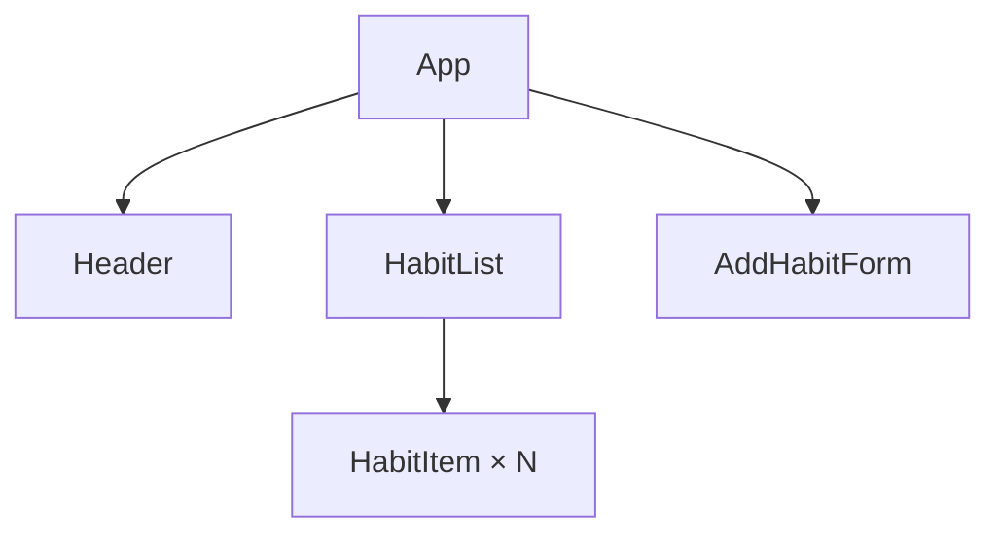

> **Термін здачі:** 21.12.2026.

> **Примітка щодо актуальності.** Документ підготовлено станом на 7 листопада
> 2026 року: React 19, Vite 8, Next.js 16, React Router 8, React Hook Form 7,
> Zod 4, Zustand 5, Redux Toolkit 2, Jotai 3, TanStack Query 5, Vitest 5,
> TypeScript 7. У разі відмінностей орієнтуйтеся на документацію бібліотек
> (§8).

## 1. Мета

Розробити, опублікувати й захистити власний застосунок на React і показати
володіння темами курсу в обсязі обраного рівня: від компонентів і стану до
маршрутизації, роботи з REST API, форм, доступності, глобального стану,
кешування серверних даних, тестування й TypeScript.

**Очікуваний результат:** репозиторій на GitHub із застосунком на Vite або
Next.js; застосунок відкривається на Vercel; у `README.md` — опис, діаграми
й підсумок зробленого; усний захист на екзамені 24.12.2026.

## 2. Як формується оцінка

> **Презентації плануйте заздалегідь.** Для рівнів C, B і A потрібні дві
> презентації. Їх захищають протягом семестру на лекціях, до тем яких вони
> належать, тож теми погодьте з викладачем на початку семестру, а не в
> грудні. Перелік тем — у [Лекції 0](/react/lectures/lecture-0/).

Рівні накопичувальні: кожен наступний містить усі вимоги попередніх.

| Рівень | Бали   | Застосунок                                                                                                                                                                                                                                                             | Також                                                       |
| ------ | ------ | ---------------------------------------------------------------------------------------------------------------------------------------------------------------------------------------------------------------------------------------------------------------------- | ----------------------------------------------------------- |
| E      | 61&#8288;–&#8288;67  | Застосунок на Vite або Next.js: компоненти й пропси, `useState`/`useEffect`, обробники подій, списки з ключами, керована форма; опубліковано на Vercel; у README — дерево компонентів у Mermaid                                                                         | Усний захист                                                |
| D      | 68&#8288;–&#8288;75  | + маршрутизація (React Router або App Router у Next.js) з кількома маршрутами, один — з параметром; публічний REST API: список і сторінка деталей, стани завантаження, помилки й порожнього результату, модуль API, скасування запитів з браузера                       | Усний захист                                                |
| C      | 76&#8288;–&#8288;82  | + спільний стан через `useReducer` або Context, власний хук, форма на React Hook Form + Zod, що надсилає запит на запис, перевірка axe без порушень, діаграма потоку даних у Mermaid                                                                                     | 2 презентації; усний захист                                 |
| B      | 83&#8288;–&#8288;90  | + Zustand, Redux Toolkit або Jotai, обґрунтований патерн проєктування React                                                                                                                                                                                            | 2 презентації; усний захист                                 |
| A      | 91&#8288;–&#8288;100 | + TanStack Query (або RTK Query, якщо обрано Redux Toolkit) замість власного коду запитів, мемоізація, підтверджена в React Profiler, тести на Vitest і React Testing Library, строгий TypeScript                                                                                                                 | 2 презентації; усний захист                                 |

1. **Оцінку визначає найвищий рівень, усі вимоги якого виконано й
   захищено.** Якщо ви подали застосунок рівня B, але не можете пояснити, як
   у ньому працює стейт-менеджер, оцінка — C.
2. **Без захисту оцінки немає.** Якщо не вдається захистити навіть рівень E,
   оцінка — FX, і завдання захищають на повторному складанні.
3. **Місце в межах діапазону балів залежить від реалізації та захисту
   разом.** Повністю й охайно виконаний рівень, упевнено захищений, — ближче
   до верхньої межі. Рівень, виконаний з недоліками або з відповідями, які
   потребують підказок, — ближче до нижньої.
4. **На захисті ви змінюєте код наживо, без AI-агента** (близько 5 хвилин):
   наприклад, додаєте фільтр або піднімаєте стан на рівень вище.

Презентація — дослідження за темою лекції з демонстрацією прикладів коду.
Тему й дату погоджують з викладачем.

## 3. Тема

### 3.1. Рівні E і D

Можна взяти тему, API і стилі власного індивідуального завдання з курсу
«Сучасна веброзробка: HTML, CSS, JS/TS», будь-яку тему з
[таблиці тем того завдання](/web-development/labs/individual/#4-приклади-предметних-областей-та-тем-вебзастосунків)
або власну, погодивши її з викладачем. Код на React ви пишете заново.

### 3.2. Рівні C, B і A

Потрібно реалізувати складніше рішення:

- кілька пов'язаних сутностей (товари й кошики, дописи й коментарі);
- маршрути, крім списку й сторінки деталей;
- сценарій запису даних;
- спільний стан, який читають компоненти з різних частин дерева.

Оберіть тему з таблиці або запропонуйте власну.

| №   | Тема                                                       | API                                                                                                              | Запис даних                                    |
| --- | ---------------------------------------------------------- | ---------------------------------------------------------------------------------------------------------------- | ---------------------------------------------- |
| 1   | Інтернет-магазин: каталог, кошик, оформлення замовлення     | [DummyJSON](https://dummyjson.com/docs): `products`, `carts`                                                     | `POST /carts/add` — імітація                   |
| 2   | Книга рецептів із планувальником меню                       | [DummyJSON](https://dummyjson.com/docs/recipes): `recipes`                                                       | `POST /recipes/add` — імітація                 |
| 3   | Блог: дописи, коментарі, автори                             | [DummyJSON](https://dummyjson.com/docs/posts) або [JSONPlaceholder](https://jsonplaceholder.typicode.com/guide/) | додавання, зміна, видалення — імітація         |
| 4   | Дошка завдань (канбан)                                      | [DummyJSON](https://dummyjson.com/docs/todos): `todos`, `users`                                                  | додавання, зміна, видалення — імітація         |
| 5   | Магазин із входом користувача                               | [Platzi Fake Store API](https://api.escuelajs.co/docs): `products`, `users`, `auth`                              | справжній запис, зміна й видалення             |
| 6   | Серіали чи покемони з власними відгуками й списками перегляду | [TVmaze](https://www.tvmaze.com/api), [PokéAPI](https://pokeapi.co/docs/v2) — лише читання                     | файл `db.json` (§3.3)                          |

DummyJSON і JSONPlaceholder **імітують** запис: сервер відповідає створеним
або зміненим об'єктом, але не зберігає його, і наступний `GET` поверне старі
дані. Після успішної відповіді оновіть стан застосунку самі. У DummyJSON є
також вхід (`POST /auth/login`), на ньому можна зробити захищений маршрут; це
не обов'язково.

### 3.3. Файл як база даних

Якщо ваш API дає лише читати дані (TVmaze, PokéAPI), дані форми рівня C
зберігайте у файлі `db.json` у репозиторії:

- **Vite:** встановіть [json-server](https://github.com/typicode/json-server)
  (`npm install -D json-server`) і запустіть його окремо від застосунку:
  `npx json-server db.json`. Він піднімає на `http://localhost:3000`
  справжній REST API (GET, POST, PUT, PATCH, DELETE) за ключами файлу й
  переписує файл після кожної зміни, тож запис видно прямо в `db.json`.
- **Next.js:** читайте й записуйте файл у
  [Route Handler](https://nextjs.org/docs/app/api-reference/file-conventions/route)
  або Server Action через `fs/promises`.

Приклад `db.json` для json-server:

```json
{
  "reviews": [{ "id": "1", "showId": 82, "text": "Чудовий серіал" }]
}
```

**Запис — на localhost.** Файлова система застосунку, розгорнутого на
Vercel, доступна лише для читання, тому `db.json` записується тільки тоді,
коли застосунок запущено локально. Сценарій запису запускайте й показуйте на
захисті на localhost.

## 4. Вимоги за рівнями

Застосунок можна будувати на Vite або на Next.js. Вимоги рівнів однакові;
там, де в Next.js вимога виглядає інакше, дивіться таблицю.

| Вимога                                  | Vite                                                                                                         | Next.js                                                                                           |
| --------------------------------------- | ------------------------------------------------------------------------------------------------------------ | ------------------------------------------------------------------------------------------------- |
| Лінтер і форматування (E)               | ESLint і Prettier, як у [ЛР-1](/react/labs/lab-1/) (§4.2 і §4.4)                                             | ESLint із `create-next-app`, Prettier зі скриптом `format:check`                                  |
| Маршрутизація (D)                       | React Router: маршрут із параметром (`:id`), маршрут 404 (`*`), `vercel.json` із rewrite                      | App Router: динамічний сегмент `[id]`, сторінка `not-found`; rewrite не потрібен                   |
| Запити (D)                              | модуль API; `useEffect` зі скасуванням запиту                                                                | модуль API; запит у серверному компоненті або в клієнтському з `useEffect` і скасуванням          |
| Завантаження, помилка, порожньо (D)     | стан компонента                                                                                              | файли `loading` і `error` (повтор через `retry`), порожній стан — у компоненті                    |
| Публічні змінні оточення (D)            | `VITE_`                                                                                                      | `NEXT_PUBLIC_`                                                                                    |
| Файл як база даних (C)                  | json-server на `db.json`                                                                                     | Route Handler або Server Action, що записує `db.json`                                             |
| TanStack Query або RTK Query (A)        | замінює власний код запитів                                                                                  | для даних на клієнті: запити, мутація форми рівня C, інвалідація                                  |
| Тести (A)                               | Vitest і React Testing Library                                                                               | те саме для клієнтських компонентів; асинхронні серверні компоненти Vitest не підтримує           |

### 4.1. Рівень E

- Застосунок на React (Vite або Next.js) у власному репозиторії на GitHub, не
  в `react-labs`. JavaScript або TypeScript; якщо взяти TypeScript одразу, на
  рівні A не доведеться переписувати код.
- Власні компоненти, які отримують дані через пропси.
- `useState` і `useEffect`. Ефект робить корисну роботу: наприклад,
  синхронізує дані з `localStorage` або змінює заголовок вкладки. Дані на
  цьому рівні можуть лежати в локальному модулі або надходити з API.
- Обробники подій, список, відрендерений зі стабільними ключами (`key`), і
  керована форма.
- `npm run lint` і `npm run format:check` проходять без помилок.
- Застосунок опубліковано на Vercel.
- `README.md`: що робить застосунок, як його запустити, адреса на Vercel,
  дерево компонентів, короткий підсумок зробленого й запис про використання
  AI (§6).

Дерево компонентів — діаграма Mermaid `flowchart TD`, яку GitHub показує як
малюнок. Ось дерево іншого застосунку, «Трекера звичок»:

````markdown

````

Перевіряти діаграму зручно в [Mermaid Live Editor](https://mermaid.live/).

### 4.2. Рівень D

- Маршрутизація з кількома маршрутами; серед них сторінка деталей із
  параметром у шляху й сторінка 404. Застосунку на Vite потрібен
  `vercel.json` у корені проєкту, інакше пряме посилання на внутрішню
  сторінку після оновлення дає 404:

  ```json
  {
    "rewrites": [{ "source": "/(.*)", "destination": "/index.html" }]
  }
  ```

- Публічний REST API без секретного ключа в коді клієнта. Усе, що потрапляє
  в бандл, бачить кожен користувач, зокрема змінні `VITE_` і `NEXT_PUBLIC_`.
- Список з ендпоінту списку й сторінка деталей, яка завантажує запис за id із
  параметра маршруту.
- Запити — в окремому модулі API (`fetch` або Axios), а не всередині
  компонентів.
- Стани завантаження, помилки (з кнопкою повтору) і порожнього результату.
- Запити з браузера скасовуються в `useEffect` (`AbortController` або
  прапорець `ignore`), щоб під час швидкої навігації не з'являлися застарілі
  дані. Дані, які Next.js отримує в серверних компонентах, скасовувати не
  потрібно.

### 4.3. Рівень C

- Спільний стан через `useReducer` і/або Context, який читають компоненти з
  різних гілок дерева (наприклад, лічильник кошика в шапці й сторінка
  кошика).
- Власний хук, що прибирає справжнє дублювання коду.
- Форма на React Hook Form + Zod:
  - валідація за схемою; повідомлення про помилки прив'язані до полів
    (`aria-invalid`, `aria-describedby`);
  - надсилає запит POST, PUT, PATCH або DELETE (для API лише на читання — у
    файл `db.json`, §3.3);
  - показує успіх і обробляє помилку сервера.
- Розширення axe DevTools не знаходить порушень на жодному маршруті, а
  основний сценарій можна пройти лише клавіатурою. Результат перевірки axe —
  у README.
- Діаграма потоку даних у Mermaid: де живе кожна частина стану і як її
  передають пропси, контекст і дії. Приклад для «Трекера звичок»:

  ````markdown
  ```mermaid
  flowchart TD
    Ctx[("HabitsContext: habits, dispatch")]
    Ctx -- habits --> HabitList
    Ctx -- habits --> Stats
    AddHabitForm -- "dispatch added" --> Ctx
    HabitItem -- "dispatch toggled" --> Ctx
  ```
  ````

- Дві презентації за темами лекцій (§2).

### 4.4. Рівень B

- Спільний стан клієнта — у Zustand, Redux Toolkit або Jotai (одна
  бібліотека на вибір). Дані з сервера лишаються в модулі API.
- Патерн проєктування React, який розв'язує реальну проблему у вашому
  застосунку: Container/Presentational, Render Props, HOC або Compound
  Components. Власні хуки не рахуються: їх вимагає рівень C. У README
  поясніть, чим патерн кращий за простий підхід. HOC і render props
  здебільшого замінили хуки, тож патерн, доданий лише заради оцінки, не
  зараховується.

### 4.5. Рівень A

- TanStack Query замінює власний код запитів: запити з ключами
  (`queryKey`), мутація для форми рівня C та інвалідація після неї. Якщо на
  рівні B обрано Redux Toolkit, замість TanStack Query використайте RTK Query
  з того самого пакета: ендпоінти запитів, мутація для форми рівня C та
  інвалідація через теги (`providesTags`, `invalidatesTags`).
- Проблема зайвих повторних рендерів, знайдена й виправлена та виміряна в
  React Profiler: числа або знімки екрана «до» й «після» — у README.
  Виправити можна через `React.memo`/`useMemo`/`useCallback` або React
  Compiler.
- Тести на Vitest і React Testing Library для основних сценаріїв, зокрема
  для форми й асинхронного запиту з підміненим API. `npm test` проходить.
- TypeScript зі `strict: true`, без `any`; типізовано пропси, стан і
  відповіді API; `tsc` не знаходить помилок (у шаблоні Vite його запускає
  `npm run build`).

## 5. Етапи виконання

| Крок          | Що                                                                                                       | Коли                                                                   |
| ------------- | -------------------------------------------------------------------------------------------------------- | ---------------------------------------------------------------------- |
| 1.&nbsp;Тема  | Погодьте з викладачем тему, API і цільовий рівень (§7)                                                    | На початку семестру; для C–A — так, щоб устигнути з презентаціями      |
| 2.&nbsp;Розробка | Рівні по черзі, E → D → C → B → A; кожен працює й опублікований, перш ніж братися за наступний            | Протягом семестру                                                      |
| 3.&nbsp;Подання | Лист із репозиторієм, адресою на Vercel і рівнем (§7)                                                     | До 21.12.2026                                                          |
| 4.&nbsp;Захист | Усний захист і зміна коду наживо (§2)                                                                    | На екзамені 24.12.2026                                                 |

Робіть коміт, коли завершуєте кожен рівень: на захисті історія комітів
показує, як застосунок ріс.

## 6. Що подати

1. Репозиторій на GitHub із кодом застосунку.
2. Адресу застосунку на Vercel.
3. `README.md`, у якому:
   - що робить застосунок і який рівень ви заявляєте;
   - як запустити застосунок локально, а для `db.json` — як запустити
     json-server;
   - адреса на Vercel;
   - дерево компонентів (E) і діаграма потоку даних (C) у Mermaid;
   - результат перевірки axe (C), обґрунтування патерну (B), вимірювання в
     Profiler «до» й «після» (A);
   - короткий підсумок: що зроблено на кожному рівні;
   - використання AI: яким інструментом і для чого (вимога політики курсу).

## 7. Подання роботи

Листи надсилайте на адресу
[denys.matsevych@oa.edu.ua](mailto:denys.matsevych@oa.edu.ua).

**Погодження теми** (крок 1, §5). Тема листа:

```
[React] Індивідуальне завдання: тема
```

У листі вкажіть тему, API і рівень, на який ви плануєте.

**Подання роботи** (до 21.12.2026). Тема листа:

```
[React] Індивідуальне завдання
```

У листі вкажіть репозиторій, адресу на Vercel і рівень, який ви заявляєте:

```
GitHub repository: https://github.com/<username>/<repository>
Vercel: https://<project>.vercel.app/
Рівень: C
```

## 8. Корисні посилання

_Рівень E_

1. [Швидкий старт](https://uk.react.dev/learn) — компоненти, JSX, пропси,
   стан і події в документації React.
2. [Синхронізація з ефектами](https://uk.react.dev/learn/synchronizing-with-effects)
   і [Вам може не знадобитися ефект](https://uk.react.dev/learn/you-might-not-need-an-effect) —
   коли `useEffect` потрібен, а коли ні.
3. [ЛР-1](/react/labs/lab-1/) — Vite, ESLint, Prettier і деплой на Vercel.
4. [Next.js: Installation](https://nextjs.org/docs/app/getting-started/installation) —
   якщо будуєте на Next.js.
5. [Flowcharts — Basic Syntax](https://mermaid.js.org/syntax/flowchart.html) —
   синтаксис діаграм Mermaid.

_Рівень D_

6. [React Router: Routing](https://reactrouter.com/start/declarative/routing) —
   маршрути, динамічні сегменти, `useParams`.
7. [Next.js: Dynamic Routes](https://nextjs.org/docs/app/api-reference/file-conventions/dynamic-routes),
   [loading](https://nextjs.org/docs/app/api-reference/file-conventions/loading),
   [error](https://nextjs.org/docs/app/api-reference/file-conventions/error),
   [not-found](https://nextjs.org/docs/app/api-reference/file-conventions/not-found).
8. [Vite on Vercel](https://vercel.com/docs/frameworks/frontend/vite) — rewrite
   для застосунку з клієнтською маршрутизацією.

_Рівень C_

9. [Масштабування з редюсером і контекстом](https://uk.react.dev/learn/scaling-up-with-reducer-and-context).
10. [Повторне використання логіки за допомогою власних хуків](https://uk.react.dev/learn/reusing-logic-with-custom-hooks).
11. [React Hook Form](https://react-hook-form.com/get-started),
    [Zod](https://zod.dev/) і
    [@hookform/resolvers](https://github.com/react-hook-form/resolvers) —
    `zodResolver` поєднує їх.
12. [axe DevTools](https://www.deque.com/axe/devtools/) — розширення
    браузера для перевірки доступності.
13. [json-server](https://github.com/typicode/json-server) — REST API з файлу
    `db.json`.

_Рівень B_

14. [Zustand](https://zustand.docs.pmnd.rs/),
    [Redux Toolkit](https://redux-toolkit.js.org/),
    [Jotai](https://jotai.org/).
15. [React patterns](https://www.patterns.dev/react/) — Container/Presentational,
    HOC, Render Props, Compound Components з прикладами.

_Рівень A_

16. [TanStack Query](https://tanstack.com/query/latest/docs/framework/react/overview)
    або, з Redux Toolkit,
    [RTK Query](https://redux-toolkit.js.org/rtk-query/overview).
17. [`<Profiler>`](https://uk.react.dev/reference/react/Profiler),
    [`memo`](https://uk.react.dev/reference/react/memo) і
    [React Compiler](https://uk.react.dev/learn/react-compiler).
18. [Vitest](https://vitest.dev/guide/) і
    [React Testing Library](https://testing-library.com/docs/react-testing-library/intro/);
    для Next.js — [Setting up Vitest](https://nextjs.org/docs/app/guides/testing/vitest).
19. [Використання TypeScript](https://uk.react.dev/learn/typescript) у
    документації React.
