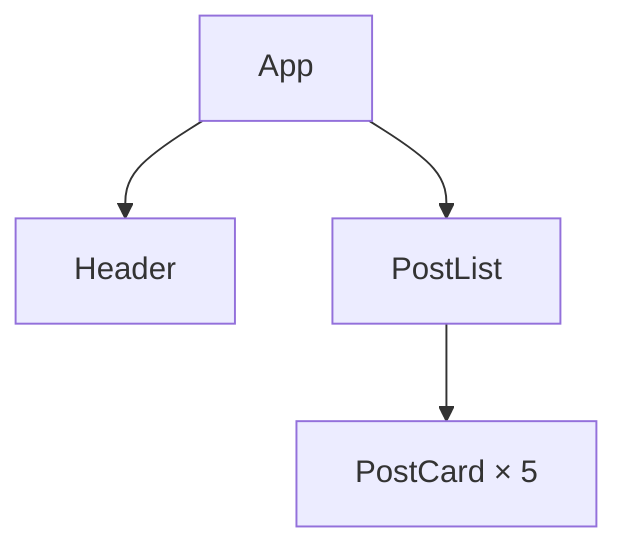

> **Примітка щодо актуальності.** Документ підготовлено станом на 5 листопада
> 2026 року: React 19, Vite 8, ESLint 10, Prettier 3. У разі відмінностей
> орієнтуйтеся на документацію React (§2).

## 1. Мета роботи

Розкласти готовий застосунок на компоненти за методом Thinking in React:
знайти ієрархію компонентів на макеті, перебудувати код за нею, не змінивши
сторінки, і визначити, які дані стануть станом.

**Очікуваний результат:** у теці `lab-3/` репозиторію `react-labs` —
сторінка «Меню кав'ярні», яка виглядає так само, як на початку роботи, але
складається з компонентів `SearchBar`, `MenuTable`, `MenuCategory` і
`MenuItemRow`; у `lab-3/README.md` — діаграма ієрархії компонентів і таблиця
стану;
застосунок відкривається на Vercel.


## 2. Корисні посилання

Теоретичної частини в цій роботі немає. Перед заняттям прочитайте кроки 1–4 на
сторінці 1 (або на сторінці 2 українською), решту відкривайте, коли до них
відсилає завдання.

1. [Thinking in React](https://uk.react.dev/learn/thinking-in-react) —
   головна сторінка роботи: п'ять кроків від макета до інтерактивного
   застосунку. Українською її ще не перекладено, тож за потреби скористайтеся
   перекладом у браузері. Крок 5 у цій роботі не потрібен.
2. [Філософія React](https://uk.legacy.reactjs.org/docs/thinking-in-react.html) —
   ті самі кроки українською, у старій документації React. Читайте її заради
   методу: приклади коду там застарілі (класові компоненти).
3. [Розуміння вашого UI як дерева](https://uk.react.dev/learn/understanding-your-ui-as-a-tree) —
   дерево рендерингу (§4.7).
4. [Передача пропсів до компонента](https://uk.react.dev/learn/passing-props-to-a-component) —
   як винесений компонент отримує дані.
5. [Рендеринг списків](https://uk.react.dev/learn/rendering-lists) — де стоїть
   `key`, коли тіло `map` стає компонентом.
6. [Умовний рендеринг](https://uk.react.dev/learn/conditional-rendering) —
   оператор `&&` у рядку «— немає».
7. [Інструменти розробника React](https://uk.react.dev/learn/react-developer-tools) —
   вкладка **Components ⚛**.
8. [Flowcharts — Basic Syntax](https://mermaid.js.org/syntax/flowchart.html) —
   синтаксис діаграм Mermaid (англійською), для діаграми ієрархії в §4.2.
   Перевіряти діаграму зручно в [Mermaid Live Editor](https://mermaid.live/).
9. [When to break up a component into multiple components](https://kentcdodds.com/blog/when-to-break-up-a-component-into-multiple-components) —
   стаття Кента Доддса (англійською, 2019) про те, коли компонент _не_ варто
   розбивати. Необов'язкова, знадобиться для захисту.

## 3. Завдання лабораторної роботи

1. Додати в репозиторій `react-labs` теку `lab-3/` зі стартового проєкту
   (§4.1).
2. Крок 1: записати ієрархію компонентів за макетом (§4.2).
3. Крок 2: винести з `App` компоненти `MenuItemRow`, `MenuCategory`,
   `MenuTable` і `SearchBar`, не змінивши сторінки (§4.3–4.6).
4. Звірити ієрархію з React DevTools; кроки 3–4: визначити стан і компонент,
   у якому він житиме (§4.7).
5. Перевірки, GitHub і Vercel (§4.8), звіт (§5).

**Усі завдання §4.1–4.8 виконуються на занятті** (орієнтовно 20–30 хвилин);
звіт (§5) можна надіслати після нього. §4.9 — додаткове завдання для тих, хто
впорався раніше.

**AI.** Код цієї роботи переносьте самостійно. AI-автодоповнення в редакторі
можна залишити ввімкненим, але кожен запропонований рядок ви маєте вміти
пояснити на захисті. Доручати рефакторинг AI-агентові не рекомендовано: мета —
навчитися самому бачити дерево компонентів і переносити код за ним.

## 4. Хід виконання роботи

Рефакторинг змінює будову коду, але не поведінку застосунку. Тому після
кожного кроку §4.3–4.6 сторінка в браузері має виглядати так само, як на
початку, а у вкладці **Components ⚛** має з'являтися новий компонент. Файли
зберігайте як у ЛР-1 (`Ctrl+S`): Prettier відформатує їх під час збереження.

### 4.1. Стартовий проєкт

1. Відкрийте в редакторі теку `react-labs` і перевірте, що `git status` чистий.
   Якщо працюєте на іншому комп'ютері, спершу клонуйте `react-labs` з GitHub.
2. Завантажте [lab-3.zip](/react/labs/lab-3.zip) і розпакуйте його в
   провіднику (Windows: **Extract All**, macOS: подвійний клік). Вийде тека
   `lab-3`. Перемістіть її в корінь `react-labs`, поруч із теками попередніх
   робіт.

   Не розпаковуйте архів командою в терміналі в корені `react-labs`: файли в
   ньому лежать без теки й замінили б кореневі `package.json` і `.gitignore`.

3. У корені репозиторію виконайте `git status -u`: усі нові файли мають бути
   в `lab-3/`.
4. Встановіть залежності в корені й запустіть dev-сервер:

   ```bash
   npm install
   cd lab-3
   npm run dev
   ```

   `npm install` додає `lab-3` у кореневий `package-lock.json`. Відкрийте
   http://localhost:5173: меню вже працює. Поле пошуку й прапорець поки нічого
   не роблять: це статична версія, яка лише показує дані. Dev-сервер не
   зупиняйте до §4.8, а для команд git відкрийте другий термінал (у VS Code —
   **+** на панелі терміналу): він відкривається в корені `react-labs`.

5. Що вже є в проєкті:

   | Файл                                                   | Що в ньому                                                                                                       |
   | ------------------------------------------------------ | ---------------------------------------------------------------------------------------------------------------- |
   | `src/App.jsx`                                          | увесь застосунок — один компонент `App`                                                                          |
   | `src/data.js`                                          | масив `menu`: три категорії з полями `id`, `name`, `items`; кожна позиція має `id`, `name`, `price`, `available` |
   | `src/index.css`                                        | усі стилі сторінки; класи вже стоять у розмітці `App.jsx` і переїжджають разом із нею                            |
   | `README.md`                                            | діаграма ієрархії компонентів і таблиця стану, які ви заповните в §4.2 і §4.7                                    |
   | `package.json`, `eslint.config.js`, `.prettierrc.json` | скрипти й налаштування ESLint і Prettier, як у ЛР-1                                                              |

6. Зробіть коміт у корені репозиторію: так до нього потрапить і
   `package-lock.json`.

   ```bash
   git add .
   git commit -m "chore: add lab 3 starter"
   ```

Далі шляхи до файлів (`src/App.jsx`) — відносно `lab-3/`.

### 4.2. Крок 1: ієрархія компонентів

Thinking in React починається з макета: на ньому обводять рамкою кожну
частину інтерфейсу, яка має одну відповідальність. Кожна рамка — майбутній
компонент. На макеті нижче рамки вже намальовано:


| №   | Компонент      | Що відображає                               |
| --- | -------------- | ------------------------------------------- |
| 1   | `App`          | уся сторінка                                |
| 2   | `SearchBar`    | поле пошуку й прапорець                     |
| 3   | `MenuTable`    | таблиця з рядком заголовків «Позиція, Ціна» |
| 4   | `MenuCategory` | одна категорія: її назва й позиції          |
| 5   | `MenuItemRow`  | одна позиція: назва й ціна                  |

Той самий поділ є в прикладі на react.dev (посилання 1 з §2):

| react.dev                                | ЛР-3           |
| ---------------------------------------- | -------------- |
| `FilterableProductTable`                 | `App`          |
| `SearchBar`                              | `SearchBar`    |
| `ProductTable`                           | `MenuTable`    |
| `ProductCategoryRow` і рядки після нього | `MenuCategory` |
| `ProductRow`                             | `MenuItemRow`  |

Рамка всередині іншої рамки — дочірній компонент. Кілька однакових рамок —
кілька екземплярів одного компонента.

Запишіть ієрархію в `lab-3/README.md` діаграмою Mermaid: у розділі
«Ієрархія компонентів» уже є блок `mermaid` з першим рядком діаграми й
коренем `App`. Допишіть у нього решту компонентів, від `App` до
`MenuItemRow`:

- `flowchart TD` — діаграма-дерево згори вниз;
- рядок `Батько --> Дитина` — стрілка від компонента до його дочірнього
  компонента;
- кілька екземплярів позначайте одним вузлом з підписом у лапках:
  `Дитина["Дитина × 3"]`.

Приклад для іншого застосунку, блогу:



Щоб побачити діаграму, скопіюйте її рядки, від `flowchart TD` до останнього,
у [Mermaid Live Editor](https://mermaid.live/). GitHub показує такий блок
діаграмою прямо в `README.md` (§4.8); у редакторі коду він може виглядати як
звичайний текст.

**Що має вийти:** у `README.md` — діаграма з п'яти компонентів, яку Mermaid
Live Editor показує без помилок. У §4.7 ви звірите її з React DevTools.

**Коміт:** `docs: add the lab 3 component tree`.
**Довідка:** [Step 1: Break the UI into a component hierarchy](https://uk.react.dev/learn/thinking-in-react#step-1-break-the-ui-into-a-component-hierarchy),
[Крок 1 українською](https://uk.legacy.reactjs.org/docs/thinking-in-react.html#step-1-break-the-ui-into-a-component-hierarchy),
[Flowcharts — Basic Syntax](https://mermaid.js.org/syntax/flowchart.html).

### 4.3. `MenuItemRow`: перший компонент за рецептом

Крок 2 Thinking in React — статична версія: компоненти, які лише показують
дані, отримані через пропси. У вас статична версія вже є, але в одному
компоненті. Розкладайте її знизу вгору: спершу найменший компонент, потім ті,
що його містять. Кожен компонент виносьте за тим самим рецептом.

> **Як винести компонент**
>
> 1. Створіть файл `src/components/<Назва>.jsx` з функцією
>    `export default function <Назва>()`.
> 2. Виріжте з `App.jsx` розмітку, яку відображає компонент, і вставте її в
>    `return` нової функції.
> 3. Знайдіть у вирізаній розмітці змінні з `App`: вони стають пропсами.
>    Додайте їх у деструктуризацію параметра функції й передайте з `App`.
> 4. Якщо на вирізаному елементі був `key`, приберіть його: `key` ставлять на
>    компонент усередині `map`.
> 5. Імпортуйте новий компонент там, де він тепер використовується. Імпорт,
>    який у файлі більше не потрібен, видаліть: ESLint підкреслить його
>    червоним.
> 6. Збережіть файли й перевірте: сторінка не змінилася.

Перший компонент — рядок позиції:

1. Створіть теку `src/components/` і в ній файл `MenuItemRow.jsx`. Виріжте з
   `App.jsx` весь рядок позиції всередині `category.items.map(...)`: від `<tr`
   до `</tr>`. Вирізана розмітка використовує одну змінну з `App` — `item`,
   тож це єдиний проп, а `key` з `<tr>` прибрано:

   ```jsx
   export default function MenuItemRow({ item }) {
     return (
       <tr className={item.available ? 'item' : 'item unavailable'}>
         <th scope="row">
           {item.name}
           {!item.available && ' — немає'}
         </th>
         <td>{item.price} грн</td>
       </tr>
     )
   }
   ```

   `{!item.available && ' — немає'}` додає текст лише тоді, коли позиції немає
   в наявності: сірий колір не всі розрізняють, тому стан позиції видно й
   словами.

2. На місці вирізаного рядка в `App.jsx` має залишитися:

   ```jsx
   {category.items.map((item) => (
     <MenuItemRow key={item.id} item={item} />
   ))}
   ```

   `key` тепер стоїть на `<MenuItemRow>`: React розрізняє елементи списку
   саме в `map`, а сам компонент свого `key` не отримує.

3. Додайте на початок `App.jsx` імпорт:

   ```jsx
   import MenuItemRow from './components/MenuItemRow.jsx'
   ```

**Що має вийти:** сторінка не змінилася. У DevTools → **Components ⚛** під
`App` — десять `MenuItemRow` з `key` від 1 до 10. Вкладки React стоять після
вбудованих, тож у вузькій панелі DevTools ця вкладка може сховатися в меню
`»`.

**Коміт:** `refactor: extract MenuItemRow`.
**Довідка:** [Step 2: Build a static version in React](https://uk.react.dev/learn/thinking-in-react#step-2-build-a-static-version-in-react),
[Збереження порядку елементів списку за допомогою key](https://uk.react.dev/learn/rendering-lists#keeping-list-items-in-order-with-key),
[Логічний оператор AND (&&)](https://uk.react.dev/learn/conditional-rendering#logical-and-operator-).

### 4.4. `MenuCategory`

За рецептом винесіть у `src/components/MenuCategory.jsx` усю категорію:
`<tbody>…</tbody>` усередині `menu.map(...)`.

| Проп       | Що це                                                |
| ---------- | ---------------------------------------------------- |
| `category` | об'єкт категорії з `data.js`: `id`, `name` і `items` |

Тепер `MenuItemRow` рендерить не `App`, а `MenuCategory`, тож імпорт
`MenuItemRow` переїжджає з `App.jsx` у `MenuCategory.jsx`. Шлях у ньому —
`./MenuItemRow.jsx`: обидва файли лежать в одній теці. На місці `<tbody>` в
`App.jsx` залиште:

```jsx
{menu.map((category) => (
  <MenuCategory key={category.id} category={category} />
))}
```

**Що має вийти:** сторінка не змінилася. У Components ⚛ — три `MenuCategory`
з ключами `coffee`, `tea` і `desserts`, у кожній — її `MenuItemRow`.

**Коміт:** `refactor: extract MenuCategory`.

### 4.5. `MenuTable`

За рецептом винесіть у `src/components/MenuTable.jsx` усю таблицю:
`<table>…</table>`.

| Проп   | Що це                       |
| ------ | --------------------------- |
| `menu` | масив категорій з `data.js` |

Імпорт `MenuCategory` переїжджає в `MenuTable.jsx`, а імпорт `menu` з
`data.js` залишається в `App.jsx`: дані приходять у компоненти згори, через
пропси. На місці таблиці в `App.jsx` залиште:

```jsx
<MenuTable menu={menu} />
```

**Що має вийти:** сторінка не змінилася. У Components ⚛: `App` → `MenuTable` →
три `MenuCategory`.

**Коміт:** `refactor: extract MenuTable`.

### 4.6. `SearchBar`

За рецептом винесіть у `src/components/SearchBar.jsx` блок
`<search>…</search>`. Пропсів у нього немає: статична версія лише показує
поле й прапорець. Які пропси він отримає, коли пошук запрацює, ви визначите в
§4.7.

Після цього кроку `src/App.jsx` має бути таким (порожні рядки між
елементами можуть залишитися):

```jsx
import SearchBar from './components/SearchBar.jsx'
import MenuTable from './components/MenuTable.jsx'
import { menu } from './data.js'

export default function App() {
  return (
    <main className="app">
      <h1>Меню кав'ярні</h1>
      <SearchBar />
      <MenuTable menu={menu} />
    </main>
  )
}
```

**Що має вийти:** сторінка не змінилася, а `App.jsx` складається лише із
заголовка й двох компонентів.

**Коміт:** `refactor: extract SearchBar`.

### 4.7. Ієрархія в DevTools і стан

1. У вкладці **Components ⚛** розгорніть усе дерево й порівняйте його з
   діаграмою в `README.md`. Якщо вони відрізняються, виправте діаграму:
   тепер це дерево рендерингу вашого застосунку. Виберіть будь-який
   `MenuItemRow` і знайдіть поле **rendered by**: хто його рендерить?
2. Крок 3: заповніть у `README.md` таблицю «Стан». Для кожного рядка дайте
   відповідь на три питання над таблицею: у стовпці «Стан?» — «так» або «ні»,
   у стовпці «Чому» — коротко чому.
3. Крок 4: допишіть рядок «Стан житиме в компоненті …». Визначте, які
   компоненти використовують дані, що виявилися станом: хто їх показує і хто
   за ними фільтрує. Стан житиме в їхньому найближчому спільному батьківському
   компоненті.

Код для стану (`useState`) — тема Лекції 2 і ЛР-4; у цій роботі стан лише
визначають.

**Коміт:** `docs: check the tree and describe the state`.
**Довідка:** [Дерево рендерингу](https://uk.react.dev/learn/understanding-your-ui-as-a-tree#the-render-tree),
[Step 3: Find the minimal but complete representation of UI state](https://uk.react.dev/learn/thinking-in-react#step-3-find-the-minimal-but-complete-representation-of-ui-state),
[Step 4: Identify where your state should live](https://uk.react.dev/learn/thinking-in-react#step-4-identify-where-your-state-should-live),
українською — [крок 3](https://uk.legacy.reactjs.org/docs/thinking-in-react.html#step-3-identify-the-minimal-but-complete-representation-of-ui-state)
і [крок 4](https://uk.legacy.reactjs.org/docs/thinking-in-react.html#step-4-identify-where-your-state-should-live).

### 4.8. Перевірки, GitHub і Vercel

1. Зупиніть dev-сервер (`Ctrl+C`) і виконайте в `lab-3/`:

   ```bash
   npm run lint
   npm run format:check
   npm run build
   ```

   Усі три команди мають пройти без помилок. Якщо `format:check` назве файл,
   відкрийте його, збережіть ще раз і закомітьте:
   `style: format lab 3 files`.

2. Відправте коміти на GitHub: `git push`. Історія комітів цієї роботи:

   1. `chore: add lab 3 starter`;
   2. `docs: add the lab 3 component tree`;
   3. `refactor: extract MenuItemRow`;
   4. `refactor: extract MenuCategory`;
   5. `refactor: extract MenuTable`;
   6. `refactor: extract SearchBar`;
   7. `docs: check the tree and describe the state`.

   Відкрийте `lab-3/README.md` на GitHub: блок `mermaid` має показатися
   діаграмою. Якщо замість неї GitHub пише про помилку, виправте діаграму,
   закомітьте (`docs: fix the lab 3 component tree`) і знову виконайте
   `git push`.

3. На [vercel.com](https://vercel.com) → **Add New → Project** ще раз
   імпортуйте `react-labs`: це буде ще один проєкт з того самого репозиторію.
   Перед **Deploy** налаштуйте:

   | Поле             | Значення                         |
   | ---------------- | -------------------------------- |
   | Project Name     | `react-lab-3`                    |
   | Root Directory   | **Edit** → `lab-3`               |
   | Framework Preset | Vite (Vercel розпізнає його сам) |
   | Output Directory | `dist`                           |

4. Після деплою скопіюйте адресу застосунку з вкладки **Overview** проєкту,
   поле **Domains**, і відкрийте її: має відкритися «Меню кав'ярні».

### 4.9. Додаткове завдання

Не обов'язкове й не оцінюється. Навчіть таблицю ховати позиції, яких немає в
наявності, поки що лише через пропси:

1. У `App.jsx` передайте в `MenuTable` ще один проп:
   `<MenuTable menu={menu} inStockOnly={false} />`. `false` відповідає
   знятому прапорцю «Лише в наявності».
2. `MenuTable` приймає `inStockOnly` і передає його далі кожному
   `MenuCategory`.
3. `MenuCategory` приймає `inStockOnly` і перед `return` вибирає позиції:

   ```jsx
   const items = inStockOnly
     ? category.items.filter((item) => item.available)
     : category.items
   ```

   Далі в розмітці замініть `category.items` на `items` — і в `map`, і в
   кількості позицій.

Сторінка не зміниться. Тепер виберіть `MenuTable` у Components ⚛ і
перемкніть `inStockOnly` у **props**: позиції «— немає» зникнуть з усієї
таблиці, а лічильники в заголовках зменшаться. Прапорець на сторінці досі
нічого не робить: щоб він керував цим значенням, `inStockOnly` має стати
станом у `App`. Коміт: `feat: hide unavailable items with a prop`.

## 5. Вимоги до звіту

**Тема листа:**

```
[React] ЛР-3: Thinking in React
```

У листі вкажіть теку лабораторної на GitHub і адресу застосунку на Vercel:

```
GitHub repository: https://github.com/<username>/react-labs/tree/main/lab-3
Vercel: https://<project>.vercel.app/
```

Звіт повинен містити:

1. знімок екрана сторінки з відкритою вкладкою **Components ⚛**, де розгорнуто
   все дерево компонентів;
2. знімок екрана `npm run lint`, `npm run format:check` і `npm run build` без
   помилок;
3. чи використовували AI-агента і для чого;
4. короткий висновок: що зроблено й що було складним.

Ієрархія компонентів і таблиця стану лежать у `lab-3/README.md`, у звіт їх
можна продублювати.

## 6. Усний захист

Формат здачі передбачає усну співбесіду за результатами роботи. Питання
нижче — типові питання співбесіди frontend-розробника з тем цієї роботи.
Відповідайте на прикладах власного коду. Викладач може попросити показати
відповідь у коді чи DevTools або змінити код наживо.

**Питання для підготовки:**

_Thinking in React_

- З яких п'яти кроків складається підхід Thinking in React? Які з них ви
  виконали в цій роботі, а які — ні і чому?
- Чому починають з макета й ієрархії компонентів, а не з коду?
- Що таке принцип єдиної відповідальності? Як він допомагає провести межу
  компонента?
- Як структура даних (`menu` → `items`) підказує ієрархію компонентів?
- Чому рядок заголовків «Позиція, Ціна» — частина `MenuTable`, а не окремий
  компонент? Коли його варто винести?
- Що таке статична версія? Чому в ній немає стану?
- Згори вниз чи знизу вгору: у якому порядку будувати компоненти? Що радить
  react.dev для малих і великих застосунків? Чому в цій роботі — знизу вгору?

_Рефакторинг_

- Що таке рефакторинг? Як ви перевіряли, що поведінка не змінилася?
- Як ви визначали, які пропси потрібні винесеному компоненту?
- Чому `key` переїхав з `<tr>` на `<MenuItemRow>`? Що буде, якщо залишити його
  лише всередині компонента?
- Що станеться, якщо забути перенести імпорт або залишити зайвий? Хто це
  помітить: Vite, браузер чи ESLint?
- Коли компонент _не_ варто розбивати на менші?
- Чим коміт `refactor:` відрізняється від `feat:`?
- Чи змінився DOM після рефакторингу? Чи додає компонент власні вузли в DOM?

_Пропси й потік даних_

- Що таке односпрямований потік даних? Як `menu` з `data.js` доходить до
  `MenuItemRow`?
- Чому `MenuTable` отримує `menu` пропсом, а не імпортує `data.js` сам?
- Що таке prop drilling? Чи є він у цьому застосунку? А в додатковому
  завданні?
- Чому `SearchBar` не має пропсів? Які пропси він отримає, коли пошук
  запрацює?

_Стан_

- Що таке стан? Чим він відрізняється від пропсів?
- Які три питання допомагають вирішити, чи є дані станом? Застосуйте їх до
  своєї таблиці.
- Чому відфільтровані позиції й кількість позицій у категорії — не стан?
- Що означає «мінімальне, але повне» представлення стану? Чим погано
  зберігати в стані те, що можна обчислити?
- У якому компоненті житиме стан пошуку і чому саме там?
- Що таке зворотний потік даних (крок 5)?

_Дерева й DevTools_

- Як змінилося дерево рендерингу після рефакторингу? А дерево залежностей
  модулів?
- Чому тут дерево залежностей модулів має ту саму форму, що й дерево
  рендерингу? Коли вони розходяться?
- Які компоненти у вашому застосунку кореневі, а які — листки?
- Хто рендерить `MenuItemRow`? Що DevTools показує в полі **rendered by**?

## 7. Критерії готовності

Роботу зараховано після захисту (§6); вона оцінюється в 1 бал.

| Критерій       | Мінімальна вимога                                                                                                          |
| -------------- | -------------------------------------------------------------------------------------------------------------------------- |
| Проєкт         | `lab-3/` у репозиторії `react-labs`; у теці `npm run lint`, `npm run format:check` і `npm run build` проходять без помилок |
| Сторінка       | така сама, як на знімку в §1                                                                                               |
| Компоненти     | `SearchBar`, `MenuTable`, `MenuCategory`, `MenuItemRow` — кожен у своєму файлі в `src/components/`, з `export default`     |
| `App`          | рендерить лише заголовок, `SearchBar` і `MenuTable`; `data.js` імпортує тільки `App.jsx`                                   |
| Пропси й `key` | дані йдуть пропсами `menu` → `category` → `item`; `key` стоїть на компонентах у `map`                                      |
| Ієрархія       | діаграма Mermaid у `lab-3/README.md` показується на GitHub і відповідає вкладці Components ⚛                               |
| Стан           | таблицю «Стан» у `README.md` заповнено, рядок «Стан житиме в компоненті…» дописано                                         |
| GitHub         | коміти з §4.8                                                                                                              |
| На занятті     | усі коміти §4.1–4.8 відправлено на GitHub під час заняття (час `git push` видно на сторінці **Activity** репозиторію)      |
| Vercel         | проєкт з Root Directory `lab-3`; адреса показує сторінку з останнього коміту `main`                                        |
| Звіт           | усі пункти §5                                                                                                              |
