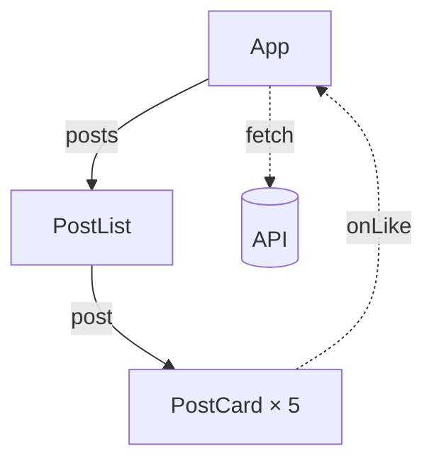

> **Примітка щодо актуальності.** Документ підготовлено станом на 8 листопада
> 2026 року: React 19, Vite 8, ESLint 10 з `eslint-plugin-react-hooks` 7,
> Prettier 3, React DevTools 8. У разі відмінностей орієнтуйтеся на
> документацію React (§2).

## 1. Мета роботи

Оживити «Меню кав'ярні» з ЛР-3 за кроками 4 і 5 Thinking in React: зберегти
текст пошуку й позначку прапорця в стані (`useState`), передати їх униз
пропсами, а зміни повертати вгору через функції-обробники; зберігати фільтри
між перезавантаженнями сторінки за допомогою `useEffect`.

**Очікуваний результат:** у теці `lab-4/` репозиторію `react-labs` —
«Меню кав'ярні», у якому пошук фільтрує позиції під час введення, прапорець
«Лише в наявності» ховає позиції, яких немає, а після перезавантаження
сторінки фільтри відновлюються; у `lab-4/README.md` — діаграма потоку даних;
застосунок відкривається на Vercel. За додатковий бал (§4.7) стан живе в
окремому компоненті `FilterableMenuTable`.


## 2. Корисні посилання

Теоретичної частини в цій роботі немає. Перед заняттям прочитайте кроки 4 і
5 за посиланням 1 (або за посиланням 2 — українською) і сторінку за
посиланням 3. Решту відкривайте, коли до них відсилає завдання.

1. [Thinking in React](https://uk.react.dev/learn/thinking-in-react) —
   головна сторінка роботи, кроки 4 і 5. Українською її ще не перекладено,
   тож за потреби скористайтеся перекладом у браузері.
2. [Філософія React](https://uk.legacy.reactjs.org/docs/thinking-in-react.html) —
   ті самі кроки українською, у старій документації React. Читайте її заради
   методу: приклади коду там застарілі (класові компоненти, `this.state`).
3. [Стан: пам'ять компонента](https://uk.react.dev/learn/state-a-components-memory) —
   `useState` і чому звичайна змінна не зберігає значення між рендерами.
4. [Поширення стану між компонентами](https://uk.react.dev/learn/sharing-state-between-components) —
   підняття стану до спільного батьківського компонента (§4.2). Розділ про
   контрольовані й неконтрольовані компоненти знадобиться в ЛР-5.
5. [Реагування на події](https://uk.react.dev/learn/responding-to-events) —
   обробники подій і передача їх пропсами (§4.3).
6. [Synchronizing with Effects](https://uk.react.dev/learn/synchronizing-with-effects) —
   що таке ефект, масив залежностей, подвійний запуск у режимі розробки
   (англійською, §4.4).
7. [You Might Not Need an Effect](https://uk.react.dev/learn/you-might-not-need-an-effect) —
   коли ефект не потрібен; чому фільтрування меню — не ефект (англійською).
8. [Використовуємо хук ефекту](https://uk.legacy.reactjs.org/docs/hooks-effect.html) —
   `useEffect` українською, у старій документації React; приклади там уже
   на функціональних компонентах.
9. [useState: Avoiding recreating the initial state](https://uk.react.dev/reference/react/useState#avoiding-recreating-the-initial-state) —
   функція-ініціалізатор (англійською, §4.4).
10. [Window.localStorage](https://developer.mozilla.org/en-US/docs/Web/API/Window/localStorage) —
    сховище браузера (MDN, англійською).
11. [View and edit local storage](https://developer.chrome.com/docs/devtools/storage/localstorage) —
    вкладка **Application** у DevTools (англійською, §4.4).
12. [Flowcharts — Basic Syntax](https://mermaid.js.org/syntax/flowchart.html) —
    підписи на стрілках і пунктирні стрілки в Mermaid (англійською, §4.5).
13. [State Colocation will make your React app faster](https://kentcdodds.com/blog/state-colocation-will-make-your-react-app-faster) —
    стаття Кента Доддса про колокацію стану (англійською, §4.7).

## 3. Завдання лабораторної роботи

1. Додати в репозиторій `react-labs` теку `lab-4/` зі стартового проєкту
   (§4.1).
2. Крок 4: додати стан пошуку й прапорця в `App` і передати його пропсами
   (§4.2).
3. Крок 5: повертати зміни з `SearchBar` у стан — зворотний потік даних
   (§4.3).
4. Зберігати фільтри між перезавантаженнями сторінки за допомогою
   `useEffect` (§4.4).
5. Перетворити діаграму компонентів на діаграму потоку даних (§4.5).
6. Перевірки, GitHub і Vercel (§4.6), звіт (§5).
7. **+1 бал:** перенести стан в окремий компонент `FilterableMenuTable`
   (§4.7).

**Усі завдання §4.1–4.7 виконуються на занятті** (орієнтовно 20–30 хвилин);
звіт (§5) можна надіслати після нього. §4.1–4.6 — основна частина, вона
оцінюється в 1 бал. §4.7 дає ще 1 бал; беріться за неї, лише коли §4.6
відправлено на GitHub. §4.8 — додаткове завдання для тих, хто впорався
раніше; воно не оцінюється.

**AI.** Код цієї роботи пишіть самостійно. AI-автодоповнення в редакторі
можна залишити ввімкненим, але кожен запропонований рядок ви маєте вміти
пояснити на захисті. Доручати роботу AI-агентові не рекомендовано: мета —
навчитися самому вирішувати, де живе стан і як зміни повертаються до нього.

## 4. Хід виконання роботи

У ЛР-3 ви виконали кроки 1–2 Thinking in React у коді, а кроки 3–4 — у
таблиці стану. Тепер стан з'явиться в коді. Після кожного кроку перевіряйте
сторінку в браузері, консоль і вкладку **Components ⚛**. Файли зберігайте як
у ЛР-1 (`Ctrl+S`): Prettier відформатує їх під час збереження.

### 4.1. Стартовий проєкт

1. Відкрийте в редакторі теку `react-labs` і перевірте, що `git status` чистий.
   Якщо працюєте на іншому комп'ютері, спершу клонуйте `react-labs` з GitHub.
2. Завантажте [lab-4.zip](/uk/react/starters/lab-4.zip) і розпакуйте його в
   провіднику (Windows: **Extract All**, macOS: подвійний клік). Вийде тека
   `lab-4`. Перемістіть її в корінь `react-labs`, поруч із теками попередніх
   робіт.

   Не розпаковуйте архів командою в терміналі в корені `react-labs`: файли в
   ньому лежать без теки й замінили б кореневі `package.json` і `.gitignore`.

3. У корені репозиторію виконайте `git status -u`: усі нові файли мають бути
   в `lab-4/`.
4. Встановіть залежності в корені й запустіть dev-сервер:

   ```bash
   npm install
   cd lab-4
   npm run dev
   ```

   Відкрийте http://localhost:5173: сторінка така сама, як наприкінці ЛР-3,
   лише під таблицею з'явився блок «Години роботи». Поле пошуку й прапорець
   поки нічого не роблять. Dev-сервер не зупиняйте до §4.6, а для команд git
   відкрийте другий термінал (у VS Code — **+** на панелі терміналу).

5. Що вже є в проєкті:

   | Файл                                                   | Що в ньому                                                                                                             |
   | ------------------------------------------------------ | ---------------------------------------------------------------------------------------------------------------------- |
   | `src/App.jsx`                                          | компонент `App`: заголовок, `SearchBar`, `MenuTable` і `CafeInfo`                                                      |
   | `src/components/`                                      | компоненти з ЛР-3 і новий `CafeInfo` — години роботи кав'ярні; пропсів він не отримує                                  |
   | `src/filterMenu.js`                                    | функція `filterMenu(menu, filterText, inStockOnly)`: повертає меню лише з позиціями, що відповідають пошуку й прапорцю |
   | `src/data.js`                                          | масив `menu`, як у ЛР-3                                                                                                |
   | `src/index.css`                                        | усі стилі сторінки                                                                                                     |
   | `README.md`                                            | діаграма компонентів, яку ви перетворите на діаграму потоку даних у §4.5                                               |
   | `package.json`, `eslint.config.js`, `.prettierrc.json` | скрипти й налаштування ESLint і Prettier, як у ЛР-1                                                                    |

6. Зробіть коміт у корені репозиторію: так до нього потрапить і
   `package-lock.json`.

   ```bash
   git add .
   git commit -m "chore: add lab 4 starter"
   ```

Далі шляхи до файлів (`src/App.jsx`) — відносно `lab-4/`.

### 4.2. Крок 4: стан у `App`

За таблицею стану з ЛР-3 станом є два значення: текст у полі пошуку й
позначка прапорця «Лише в наявності». Їх показує `SearchBar`, а фільтрує за
ними `MenuTable`, тож стан житиме в їхньому найближчому спільному
батьківському компоненті — `App`. Звірте це зі своєю таблицею в
`lab-3/README.md`.

У Vite-застосунку всі компоненти виконуються в браузері, тобто всі вони —
клієнтські компоненти. Саме в клієнтських компонентах працюють хуки
`useState` і `useEffect`; серверні компоненти, у яких хуків немає, — тема
Лекції 7 і ЛР-20.

1. У `src/App.jsx` імпортуйте `useState`:

   ```jsx
   import { useState } from 'react'
   ```

   і оголосіть стан на початку функції `App`, перед `return`:

   ```jsx
   const [filterText, setFilterText] = useState('')
   const [inStockOnly, setInStockOnly] = useState(false)
   ```

   `useState` повертає пару: поточне значення стану й функцію, яка його
   змінює (сетер). `''` і `false` — початкові значення: поле порожнє,
   прапорець знято.

2. Передайте обидва значення пропсами в `SearchBar` і `MenuTable`:

   | Компонент   | Нові пропси                 | Що з ними робить                 |
   | ----------- | --------------------------- | -------------------------------- |
   | `SearchBar` | `filterText`, `inStockOnly` | показує в полі пошуку й прапорці |
   | `MenuTable` | `filterText`, `inStockOnly` | фільтрує за ними меню            |

   `CafeInfo` нових пропсів не отримує: фільтри його не стосуються.

3. У `src/components/SearchBar.jsx` додайте `filterText` і `inStockOnly` у
   деструктуризацію параметра функції. Полю пошуку додайте атрибут
   `value={filterText}`, прапорцю — `checked={inStockOnly}`.
4. У `src/components/MenuTable.jsx` додайте ті самі пропси й імпортуйте
   функцію фільтрування:

   ```jsx
   import { filterMenu } from '../filterMenu.js'
   ```

   Перед `return` обчисліть меню, яке треба показати, а в `map` замініть
   `menu` на `visibleMenu`:

   ```jsx
   const visibleMenu = filterMenu(menu, filterText, inStockOnly)
   ```

   Відфільтроване меню — не стан: його щоразу обчислюють із меню й двох
   значень стану. Кількість позицій у заголовку категорії оновиться сама:
   `MenuCategory` рахує ті позиції, які отримала.

**Що має вийти:**

- сторінка виглядає як раніше, але ввести текст у поле пошуку чи позначити
  прапорець не вдається;
- у консолі браузера — два повідомлення React:
  ``You provided a `value` prop to a form field without an `onChange` handler. This will render a read-only field…``
  і таке саме для `checked`. Поле показує значення зі стану, а змінити цей
  стан поки нічому, тож React робить поле доступним лише для читання;
- ESLint підкреслює `setFilterText` і `setInStockOnly` (`no-unused-vars`):
  сетери ще не використовуються, вони знадобляться в §4.3;
- у **Components ⚛** виберіть `App`: у розділі **hooks** — `State: ""` і
  `State: false`. Змініть стан просто в DevTools: клацніть значення `""`,
  виділіть його (`Ctrl+A`), введіть `"чай"` разом із лапками (DevTools
  приймає значення у форматі JSON, тож рядок пишуть у лапках) і натисніть
  `Enter`. У таблиці залишиться лише «Чай (3)», а в полі пошуку на сторінці
  з'явиться «чай». Тепер позначте прапорець праворуч від `State: false`:
  «Трав'яний чай» зникне, а заголовок зміниться на «Чай (2)».

**Коміт:** `feat: keep the filters in App state`.
**Довідка:** [Step 4: Identify where your state should live](https://uk.react.dev/learn/thinking-in-react#step-4-identify-where-your-state-should-live),
[Крок 4 українською](https://uk.legacy.reactjs.org/docs/thinking-in-react.html#step-4-identify-where-your-state-should-live),
[Стан: пам'ять компонента](https://uk.react.dev/learn/state-a-components-memory),
[Поширення стану між компонентами](https://uk.react.dev/learn/sharing-state-between-components).

### 4.3. Крок 5: зворотний потік даних

Стан живе в `App`, а змінюватися має в `SearchBar`, коли користувач вводить
текст чи клацає прапорець. Компонент не може змінити стан іншого компонента
напряму, тож `App` передає `SearchBar` свої сетери пропсами, а `SearchBar`
викликає їх в обробнику події `onChange`. Так дані повертаються вгору: це і є
зворотний потік даних.

1. У `App.jsx` передайте в `SearchBar` ще два пропси:

   ```jsx
   <SearchBar
     filterText={filterText}
     inStockOnly={inStockOnly}
     onFilterTextChange={setFilterText}
     onInStockOnlyChange={setInStockOnly}
   />
   ```

2. `src/components/SearchBar.jsx` має стати таким:

   ```jsx
   export default function SearchBar({
     filterText,
     inStockOnly,
     onFilterTextChange,
     onInStockOnlyChange,
   }) {
     return (
       <search className="search-bar">
         <input
           type="search"
           placeholder="Пошук у меню"
           aria-label="Пошук у меню"
           value={filterText}
           onChange={(e) => onFilterTextChange(e.target.value)}
         />
         <label>
           <input
             type="checkbox"
             checked={inStockOnly}
             onChange={(e) => onInStockOnlyChange(e.target.checked)}
           />{' '}
           Лише в наявності
         </label>
       </search>
     )
   }
   ```

   `e.target` — елемент, у якому сталася подія: у полі пошуку беремо
   введений текст `e.target.value`, у прапорці — позначку
   `e.target.checked`. `{' '}` — пробіл між прапорцем і текстом, так Prettier
   записує його, коли переносить рядок. Поле, значення якого береться зі
   стану й змінюється через `onChange`, називають **контрольованим**
   (controlled). Чим воно відрізняється від неконтрольованого, ви розберете в
   ЛР-5.

**Що має вийти:**

- таблиця фільтрується під час введення: «чай» залишає три чаї, «ЧАЙ» — те
  саме, а категорії без жодної позиції зникають;
- прапорець ховає позиції «— немає», і кількість у заголовках зменшується;
- консоль без повідомлень React, ESLint нічого не підкреслює;
- у Components ⚛ стан `App` змінюється з кожною літерою, а разом з ним —
  пропси `SearchBar` і `MenuTable`.

**Коміт:** `feat: update the filters from the search bar`.
**Довідка:** [Step 5: Add inverse data flow](https://uk.react.dev/learn/thinking-in-react#step-5-add-inverse-data-flow),
[Крок 5 українською](https://uk.legacy.reactjs.org/docs/thinking-in-react.html#step-5-add-inverse-data-flow),
[Передача обробників подій як пропсів](https://uk.react.dev/learn/responding-to-events#passing-event-handlers-as-props).

### 4.4. `useEffect`: фільтри після перезавантаження

Введіть щось у пошук і перезавантажте сторінку (`F5`): фільтри зникли. Стан
живе, доки компонент є на сторінці; після перезавантаження React створює його
заново з початкових значень. Щоб фільтри пережили перезавантаження, збережіть
їх у `localStorage` — сховищі браузера, яке не очищується між відвідинами.
`localStorage` — зовнішня система: React про неї нічого не знає, тож
синхронізувати з нею стан — робота для ефекту.

1. **Запис.** У `App.jsx` імпортуйте `useEffect` разом з `useState`:

   ```jsx
   import { useEffect, useState } from 'react'
   ```

   і одразу після оголошень стану додайте ефект:

   ```jsx
   useEffect(() => {
     localStorage.setItem('menu.filterText', filterText)
     localStorage.setItem('menu.inStockOnly', String(inStockOnly))
   }, [filterText, inStockOnly])
   ```

   - функцію-ефект React викликає після того, як оновив сторінку;
   - масив `[filterText, inStockOnly]` — залежності, тобто значення, які
     ефект читає. React повторює ефект лише після тих рендерів, у яких
     якесь із них змінилося;
   - `localStorage` зберігає лише рядки, тому `inStockOnly` перетворено на
     рядок `'true'` або `'false'`.

2. **Читання.** Ефект лише записує. Прочитати збережене треба вже під час
   першого рендеру, щоб сторінка одразу показала збережені фільтри, тож
   замініть початкові значення в `useState` на функції-ініціалізатори:

   ```jsx
   const [filterText, setFilterText] = useState(
     () => localStorage.getItem('menu.filterText') ?? '',
   )
   const [inStockOnly, setInStockOnly] = useState(
     () => localStorage.getItem('menu.inStockOnly') === 'true',
   )
   ```

   React викликає таку функцію лише під час першого рендеру. Якщо значення
   ще не збережено, `getItem` повертає `null`: тоді `?? ''` дає порожній
   рядок, а порівняння з `'true'` — `false`.

> Не відновлюйте значення в ефекті через `setFilterText(...)`: ESLint
> позначить це помилкою `react-hooks/set-state-in-effect`. Якщо пропустити
> значення в масиві залежностей, ESLint попередить про це
> (`react-hooks/exhaustive-deps`).

У режимі розробки React запускає ефект двічі одразу після появи компонента на
сторінці, щоб перевірити його (так працює `<StrictMode>` у `main.jsx`). Цьому
ефекту повторний запуск не шкодить: він двічі запише ті самі значення.

**Що має вийти:**

- у DevTools → **Application** → **Storage** → **Local storage** →
  `http://localhost:5173` є ключі `menu.filterText` і `menu.inStockOnly`;
  їхні значення змінюються з кожною введеною літерою;
- після `F5` поле пошуку, прапорець і таблиця відновлюються такими, як були;
- у Components ⚛ в `App` три хуки: два `State` і `Effect`.

**Коміт:** `feat: save the filters in localStorage`.
**Довідка:** [Step 1: Declare an Effect](https://uk.react.dev/learn/synchronizing-with-effects#step-1-declare-an-effect),
[Step 2: Specify the Effect dependencies](https://uk.react.dev/learn/synchronizing-with-effects#step-2-specify-the-effect-dependencies),
[How to handle the Effect firing twice in development?](https://uk.react.dev/learn/synchronizing-with-effects#how-to-handle-the-effect-firing-twice-in-development),
[Використовуємо хук ефекту](https://uk.legacy.reactjs.org/docs/hooks-effect.html),
[Avoiding recreating the initial state](https://uk.react.dev/reference/react/useState#avoiding-recreating-the-initial-state).

### 4.5. Потік даних на діаграмі

У `lab-4/README.md`, у розділі «Потік даних», уже є діаграма Mermaid з
ієрархією компонентів. Перетворіть її на діаграму потоку даних:

- `A -->|"проп1, проп2"| B` — суцільна стрілка з підписом: пропси з даними,
  які батьківський компонент передає дочірньому. Якщо в підписі є кома чи
  пробіл, беріть його в лапки;
- `A -.->|"обробник"| B` — пунктирна стрілка: від компонента, який викликає
  функцію-обробник, до компонента, якому належить стан, або від компонента
  з ефектом до сховища поза React;
- `Name[("Назва")]` — циліндр: сховище поза React.

Приклад для іншого застосунку, блогу:



**Що має вийти:** Mermaid Live Editor показує діаграму без помилок. На
суцільних стрілках — пропси з даними: ті, що ви додали в §4.2, і ті, що
залишилися з ЛР-3 (`menu`, `category`, `item`); стрілка до `CafeInfo` — без
підпису. Пунктирні стрілки — від `SearchBar` до `App` з назвами обох
обробників і від `App` до `localStorage`.

**Коміт:** `docs: add the lab 4 data flow`.
**Довідка:** [Flowcharts — Basic Syntax](https://mermaid.js.org/syntax/flowchart.html),
[Mermaid Live Editor](https://mermaid.live/).

### 4.6. Перевірки, GitHub і Vercel

1. Зупиніть dev-сервер (`Ctrl+C`) і виконайте в `lab-4/`:

   ```bash
   npm run lint
   npm run format:check
   npm run build
   ```

   Усі три команди мають пройти без помилок, а `npm run lint` — ще й без
   попереджень (`warning`). Якщо `format:check` назве файл, відкрийте його,
   збережіть ще раз і закомітьте: `style: format lab 4 files`.

2. Відправте коміти на GitHub: `git push`. Історія комітів основної частини:

   1. `chore: add lab 4 starter`;
   2. `feat: keep the filters in App state`;
   3. `feat: update the filters from the search bar`;
   4. `feat: save the filters in localStorage`;
   5. `docs: add the lab 4 data flow`.

   Відкрийте `lab-4/README.md` на GitHub: блок `mermaid` має показатися
   діаграмою. Якщо замість неї GitHub пише про помилку, виправте діаграму,
   закомітьте (`docs: fix the lab 4 data flow`) і знову виконайте `git push`.

3. На [vercel.com](https://vercel.com) → **Add New → Project** ще раз
   імпортуйте `react-labs`: це буде ще один проєкт з того самого репозиторію.
   Перед **Deploy** налаштуйте:

   | Поле             | Значення                         |
   | ---------------- | -------------------------------- |
   | Project Name     | `react-lab-4`                    |
   | Root Directory   | **Edit** → `lab-4`               |
   | Framework Preset | Vite (Vercel розпізнає його сам) |
   | Output Directory | `dist`                           |

4. Після деплою скопіюйте адресу застосунку з вкладки **Overview** проєкту,
   поле **Domains**, і відкрийте її. Перевірте, що й там фільтри
   відновлюються після перезавантаження. `localStorage` у кожної адреси свій,
   тож значення на Vercel не залежать від localhost.

На цьому основну частину роботи завершено.

### 4.7. +1 бал: колокація стану, `FilterableMenuTable`

Беріться за це завдання, лише коли §4.6 відправлено на GitHub і застосунок
відкривається на Vercel. Запустіть dev-сервер знову (`npm run dev`).

1. **До.** У вкладці **Components ⚛** натисніть шестерню ⚙ праворуч від
   поля пошуку компонентів, на вкладці **General** позначте **Highlight
   updates when components render** і закрийте налаштування. Введіть літеру
   в поле пошуку на сторінці й запишіть, які компоненти DevTools обвела
   рамкою.
2. **Рефакторинг.** Застосуйте принцип колокації стану: створіть компонент
   `src/components/FilterableMenuTable.jsx`, якому належатиме стан фільтрів.
   - `FilterableMenuTable` отримує проп `menu`, містить обидва `useState` і
     `useEffect` з `App` і повертає `SearchBar` і `MenuTable` у фрагменті
     `<>…</>`;
   - `App` рендерить лише заголовок, `<FilterableMenuTable menu={menu} />` і
     `<CafeInfo />`.
3. **Після.** Знову введіть літеру в поле пошуку й запишіть, які компоненти
   обведено тепер.
4. **Результати.** Додайте в `README.md` розділ «Колокація стану» з двома
   рядками, «До:» і «Після:», — списками компонентів з кроків 1 і 3. Оновіть
   діаграму потоку даних.

**Коміти:** `refactor: move the filter state into FilterableMenuTable` і
`docs: compare renders before and after state colocation`. Перед `git push`
ще раз виконайте три перевірки з §4.6. Після `git push` Vercel оновить
застосунок сам.
**Довідка:** [Step 4: Identify where your state should live](https://uk.react.dev/learn/thinking-in-react#step-4-identify-where-your-state-should-live),
[State Colocation will make your React app faster](https://kentcdodds.com/blog/state-colocation-will-make-your-react-app-faster).

### 4.8. Додаткове завдання

Не обов'язкове й не оцінюється.

1. **«Нічого не знайдено».** Введіть у пошук «піца»: від таблиці залишиться
   сам рядок заголовків. Нехай `MenuTable` у такому разі показує
   повідомлення замість таблиці. Одразу після обчислення `visibleMenu`
   додайте:

   ```jsx
   if (visibleMenu.length === 0) {
     return <p className="empty">Нічого не знайдено</p>
   }
   ```

   Стиль `.empty` уже є в `index.css`.

2. **«Скинути фільтри».** Додайте в `SearchBar` після прапорця кнопку
   `<button type="button">Скинути фільтри</button>` і проп `onReset`, який
   кнопка викликає в `onClick`. Компонент, якому належить стан (`App` або
   `FilterableMenuTable`), передає функцію, що повертає обидва стани до
   початкових значень:

   ```jsx
   function handleReset() {
     setFilterText('')
     setInStockOnly(false)
   }
   ```

   Натисніть кнопку й подивіться в **Application** → **Local storage**:
   порожні фільтри збереглися, хоча нового коду для `localStorage` ви не
   писали. Ефект стежить за станом, хоч би що його змінило.

Коміт: `feat: show an empty state and reset the filters`.

## 5. Вимоги до звіту

**Тема листа:**

```
[React] ЛР-4: useState і useEffect
```

У листі вкажіть теку лабораторної на GitHub і адресу застосунку на Vercel:

```
GitHub repository: https://github.com/<username>/react-labs/tree/main/lab-4
Vercel: https://<project>.vercel.app/
```

Звіт повинен містити:

1. знімок екрана сторінки з увімкненим фільтром і відкритою вкладкою
   **Components ⚛**, де вибрано компонент зі станом (`App`, а після §4.7 —
   `FilterableMenuTable`) і видно його хуки;
2. знімок екрана **Application** → **Local storage** з обома ключами;
3. знімок екрана `npm run lint`, `npm run format:check` і `npm run build` без
   помилок;
4. чи виконано §4.7;
5. чи використовували AI-агента і для чого;
6. короткий висновок: що зроблено й що було складним.

Діаграма потоку даних лежить у `lab-4/README.md`, у звіт її можна
продублювати.

## 6. Усний захист

Формат здачі передбачає усну співбесіду за результатами роботи. Питання
нижче — типові питання співбесіди frontend-розробника з тем цієї роботи.
Відповідайте на прикладах власного коду. Викладач може попросити показати
відповідь у коді чи DevTools або змінити код наживо. Питання з групи
«Колокація стану» ставлять тим, хто виконав §4.7.

**Питання для підготовки:**

_Стан і `useState`_

- Що таке стан? Чим він відрізняється від пропсів і від звичайної змінної
  всередині компонента?
- Що повертає `useState`? Що відбувається після виклику сетера?
- Чому одразу після `setFilterText('чай')` змінна `filterText` у тому самому
  обробнику ще має старе значення?
- Що таке функція-ініціалізатор у `useState`? Чим
  `useState(() => localStorage.getItem(…))` відрізняється від
  `useState(localStorage.getItem(…))`?
- Чому стан не можна змінювати напряму, наприклад `filterText = 'чай'`?
- Чому хуки викликають лише на верхньому рівні компонента, а не в умовах чи
  циклах?

_Thinking in React, кроки 4–5_

- Чому в §4.2 стан опинився в `App`, а не в `SearchBar` чи `MenuTable`? Що
  станеться, якщо перенести його в `SearchBar`?
- Що таке підняття стану (lifting state up)?
- Що таке зворотний потік даних? Як текст із поля пошуку потрапляє до
  компонента, якому належить стан?
- Чому `SearchBar` отримує `setFilterText` пропсом, а не змінює стан сам?
- Що таке єдине джерело правди? Де воно для фільтрів у вашому застосунку?

_Обчислені дані_

- Чому відфільтроване меню й кількість позицій у заголовку категорії — не
  стан?
- Що не так з ефектом, який записує відфільтроване меню в окремий стан? Що
  про це каже ESLint?
- Скільки разів виконується `filterMenu`, поки ви вводите слово? Чи це
  проблема для десяти позицій? А для десяти тисяч?

_Поля й події_

- Що робить React, якщо дати полю `value` без `onChange`? Що означає
  повідомлення в консолі?
- Що таке контрольоване поле? Звідки воно бере своє значення?
- Чим `e.target.value` відрізняється від `e.target.checked`?

_`useEffect`_

- Що таке ефект? Чим він відрізняється від обробника події?
- Коли запускається ефект: до чи після того, як React оновив сторінку?
- Що означають масив залежностей `[filterText, inStockOnly]`, порожній масив
  `[]` і відсутність масиву?
- Чому в режимі розробки ефект запускається двічі? Чи шкодить це вашому
  ефекту?
- Що таке функція очищення (cleanup)? Чому вашому ефекту вона не потрібна?
  Наведіть приклад ефекту, якому вона потрібна.
- Чому збережені значення читаються в ініціалізаторі `useState`, а не в
  ефекті? Що піде не так, якщо відновлювати їх в ефекті?
- Записувати в `localStorage` можна й в обробниках `onChange`. Чим ефект
  кращий у цьому застосунку?
- Що таке зовнішня система? Наведіть приклади, коли ефект потрібен, і коли
  без нього можна обійтися.

_Колокація стану_

- Що таке колокація стану? Як вона поєднується з підняттям стану?
- Які компоненти рендерилися під час введення тексту до §4.7 і після? Чому
  саме вони? Чи змінювався при цьому вміст компонентів, які не використовують
  фільтри?
- Що змінилося в дереві рендерингу після §4.7?
- Чому `FilterableMenuTable` повертає фрагмент, а не `<div>`? Що сталося б зі
  сторінкою?
- Навіщо переносити стан з `App`, якщо швидкість застосунку майже не
  змінилася?
- Якщо `CafeInfo` має показувати, скільки позицій знайдено за фільтром, де
  тоді має жити стан?
- Чим коміт `refactor:` у §4.7 відрізняється від комітів `feat:`? Як ви
  перевірили, що поведінка не змінилася?

_`localStorage`_

- Чому `inStockOnly` повертається з `localStorage` рядком і як ви це
  врахували?
- Чому значення на localhost і на Vercel різні?
- Що не можна зберігати в `localStorage` і чому?

_Клієнтські компоненти й інструменти_

- Що таке клієнтський компонент? Чому `useState` і `useEffect` працюють лише
  в клієнтських компонентах?
- Як змінити стан компонента в React DevTools, не змінюючи коду?
- Які правила хуків перевіряє `eslint-plugin-react-hooks`? Яке з них
  спрацювало у вас?

## 7. Критерії готовності

Основна частина (§4.1–4.6) оцінюється в 1 бал після захисту (§6).
Завдання §4.7 — ще 1 бал, теж після захисту. Це додатковий бал понад
65 балів за поточну роботу.

**1 бал: §4.1–4.6**

| Критерій    | Мінімальна вимога                                                                                                                         |
| ----------- | ----------------------------------------------------------------------------------------------------------------------------------------- |
| Проєкт      | `lab-4/` у репозиторії `react-labs`; у теці `npm run lint` проходить без помилок і попереджень, `format:check` і `build` — без помилок    |
| Пошук       | таблиця фільтрується під час введення, без урахування регістру; категорії без позицій зникають                                            |
| Прапорець   | «Лише в наявності» ховає позиції «— немає»; кількість у заголовках змінюється                                                             |
| Стан        | два `useState`: `filterText` і `inStockOnly`; відфільтроване меню в стані не зберігається                                                 |
| Потік даних | `SearchBar` отримує значення й функції-обробники пропсами; `MenuTable` отримує фільтри пропсами й викликає `filterMenu`                   |
| Ефект       | один `useEffect` записує обидва значення в `localStorage`; після перезавантаження фільтри відновлюються                                   |
| Діаграма    | діаграма Mermaid у `README.md` показується на GitHub; на суцільних стрілках — пропси, пунктирні йдуть від `SearchBar` і до `localStorage` |
| GitHub      | коміти з §4.6                                                                                                                             |
| На занятті  | усі коміти §4.1–4.6 відправлено на занятті (час `git push` видно в **Activity** репозиторію)                                              |
| Vercel      | проєкт з Root Directory `lab-4`; адреса показує сторінку з останнього коміту `main`                                                       |
| Звіт        | усі пункти §5                                                                                                                             |

**+1 бал: §4.7**

| Критерій   | Мінімальна вимога                                                                                                          |
| ---------- | -------------------------------------------------------------------------------------------------------------------------- |
| Компонент  | `FilterableMenuTable` у `src/components/`: обидва `useState` і `useEffect`; повертає фрагмент із `SearchBar` і `MenuTable` |
| `App`      | без хуків; рендерить заголовок, `FilterableMenuTable` з пропсом `menu` і `CafeInfo`                                        |
| Сторінка   | така сама, як після §4.6; фільтри відновлюються після перезавантаження                                                     |
| Порівняння | у `README.md` розділ «Колокація стану»: компоненти, які рендерилися під час введення тексту, до й після рефакторингу       |
| Діаграма   | оновлена: стрілки, що несуть стан, починаються або закінчуються у `FilterableMenuTable`                                    |
| На занятті | коміти §4.7 відправлено на занятті; Vercel показує останній коміт                                                          |
