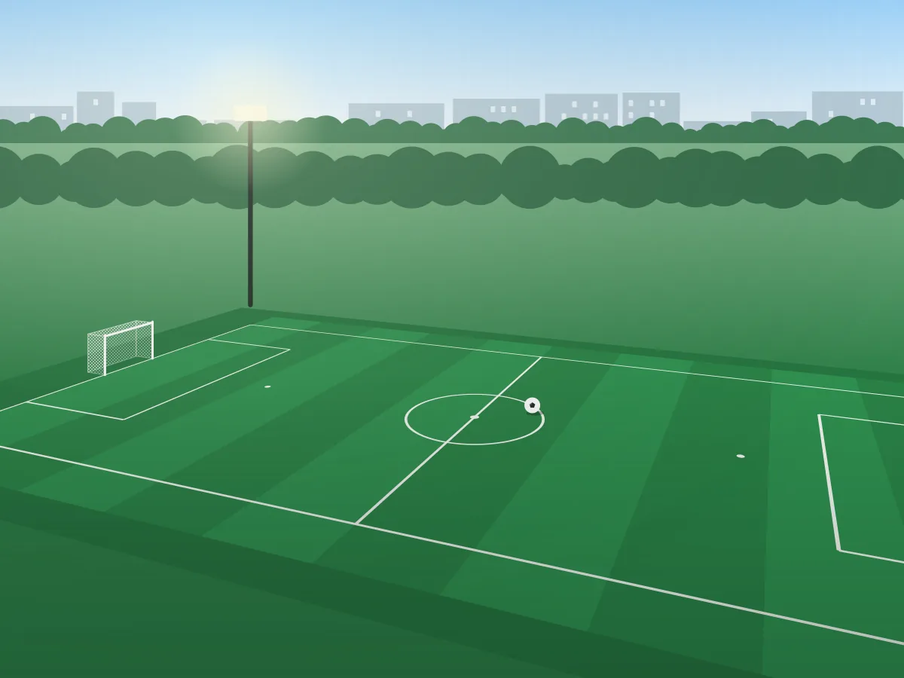

# Courtly — asset pack

Assets for Lab 7 (Module assessment 1). Start with `SPEC.md`: it says which
token is applied to each element of the mockup. The same specification
online:
<https://denysmatsevych.github.io/web-development-2026/en/web-development/labs/lab-7/task/>

All images were drawn for this assignment. You may use them freely in your
work and publish them on GitHub Pages / Vercel.

The page is in Ukrainian: copy its texts from the mockup as they are.

## Contents

```text
courtly-assets/
├── SPEC.md                 specification: tokens, grid, components, images
├── tokens.css              design tokens: colors, typography, spacing, radii
├── favicon.svg             browser tab icon
├── mockup/                 mockup captures 1 : 1 (1 px = 1 CSS px)
│   ├── mockup-desktop.webp 1440 px
│   ├── mockup-tablet.webp  768 px
│   ├── mockup-mobile.webp  375 px
│   └── mockup-mobile-menu.webp  first screen at 375 px, menu open
└── img/
    ├── logo-mark.svg       logo mark (40×40); the word "Courtly" is text in the HTML
    ├── hero-1200.webp      hero, 1200×900
    ├── hero-800.webp       hero, 800×600 — for srcset on narrow screens
    ├── arena-sport.webp    featured card, 900×1200 (portrait)
    ├── tennis-point.webp   card, 800×600
    ├── riverside-court.webp
    ├── smash-club.webp
    ├── city-football.webp
    ├── active-hall.webp
    ├── about.webp          about section, 960×1200 (portrait, 4:5)
    └── og-image.jpg        Open Graph, 1200×630
```

## How to use them

The font is Montserrat with Cyrillic (Google Fonts or self-hosted `woff2`):

```html
<link rel="preconnect" href="https://fonts.googleapis.com">
<link rel="preconnect" href="https://fonts.gstatic.com" crossorigin>
<link rel="stylesheet" href="https://fonts.googleapis.com/css2?family=Montserrat:wght@400..800&display=swap">
```

The hero image is the largest element of the first screen (LCP), so it has
**no** `loading="lazy"`:

```html

```

All other images get `width`, `height` and `loading="lazy"`.

Give `og:image` as the **absolute** URL of the published file, for example
`https://<username>.github.io/<repository>/img/og-image.jpg`.

Write the `alt` text yourself: it should describe what the image shows, not
repeat the file name.
